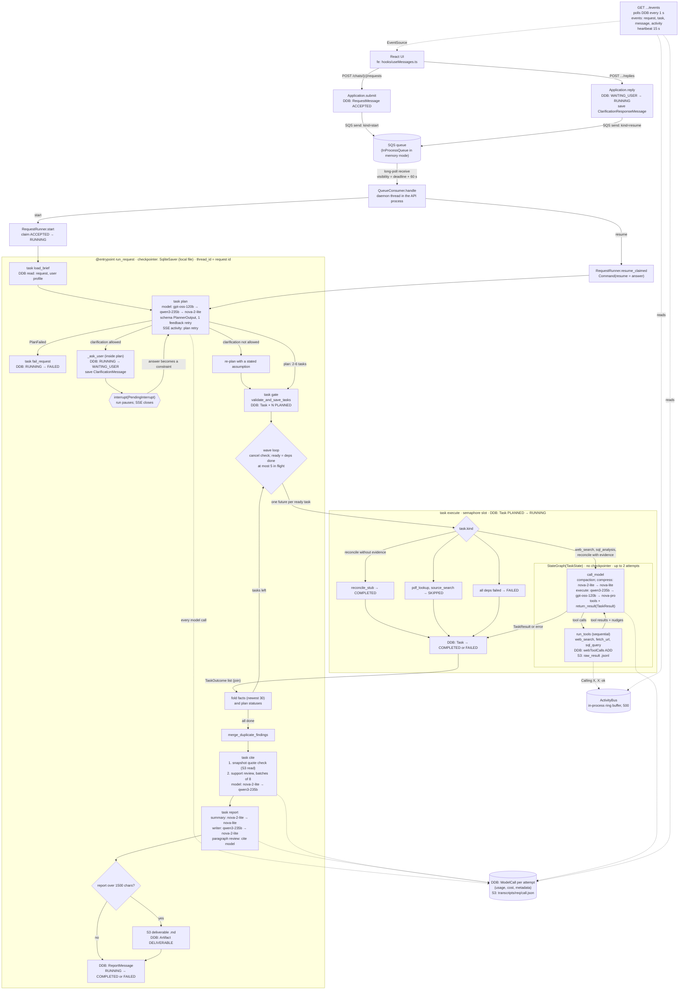

# Deep-research gap analysis: ContextForge vs five open-source agents

Date: 9 Nov 2026. Read-only audit. No code was changed, no AWS, Bedrock or web call was made.

Paths for ContextForge are relative to `src/contextforge/` unless they start with `config/`, `prompts/`, `docs/`, `tests/`, `evals/` or `scripts/`. `fe:` means the frontend repo `context-forge-frontend/src/`. Reference paths are relative to each reference repo root. Abbreviations for the references:

| Short | Repo | Commit audited | Main files |
|---|---|---|---|
| ODR | langchain-ai/open_deep_research (archived) | `1b7d2e8` | `DR` = `src/open_deep_research/deep_researcher.py`, `PR` = `.../prompts.py`, `CFG` = `.../configuration.py`, `UT` = `.../utils.py`, `ST` = `.../state.py` |
| Gemini | google-gemini/gemini-fullstack-langgraph-quickstart | `e34e569` | `G` = `backend/src/agent/graph.py`, `GP` = `.../prompts.py`, `GU` = `.../utils.py` |
| DF2 | bytedance/deer-flow 2.x (`main`) | `2a9e725` | `H/` = `backend/packages/harness/deerflow/` |
| DF1 | bytedance/deer-flow 1.x (`main-1.x`) | `2ab2876` | `src/graph/nodes.py`, `src/prompts/*.md` |
| GPTR | assafelovic/gpt-researcher | `b81060b` | `gpt_researcher/`, `multi_agents/`, `evals/` |
| DA | langchain-ai/deepagents | `4182b6f` | `DA/` = `libs/deepagents/deepagents/`, example `examples/deep_research/` |

ContextForge: backend `phase-1-engine` at HEAD `b8a54aa`; frontend `web-first`.

---

## 0. Summary

ContextForge already does several things better than every reference: hard budgets for spend, model calls, web calls and wall time (`config/budgets.yaml:2-20`, `worker/calls.py:67-86`); citations checked against saved page snapshots (`worker/stages/citation_checks.py:153-206`); per-call cost records and transcripts (`core/models/recording.py:66-195`); and real prompt-injection and SSRF controls (`infra/web_guard.py`). Its weak points are in a different place. The research loop is a static plan: one planner call fixes 2-6 tasks and nothing re-plans, reflects or adds work from findings (`core/planner.py:14-15`, `worker/workflow.py:238-263`). The model layer was built for Claude-style tool use and is now run on GPT-OSS, Qwen3 and Nova, where the per-stage `effort` and `maxTokens` settings are ignored (`core/models/config.py:24-25`, `infra/bedrock.py:61`), schema failures never fall back to another model (`worker/routing.py:4-7`) and a failed citation-review batch silently withholds its claims (`worker/stages/review.py:121-123`). Checkpoints live in a local SQLite file even in AWS mode (`api/main.py:80-82`), so a worker restart cannot resume and a killed run stays RUNNING. The eval suite has a good rubric but only human scoring and one adjudicated case (`src/contextforge/evals/web_research.py:22-35`).

Top 5 gaps, in priority order:

1. **Model-call hardening for open-weight models (P0).** Apply stage `effort`/`maxTokens`, handle `max_tokens` stops, route schema failures once to a fallback, and retry/split failed cite batches instead of dropping them.
2. **Durable checkpoints and crash recovery (P0).** A DynamoDB-backed LangGraph checkpointer, a request lease with heartbeat, and idempotent SQS start/resume.
3. **Measurable evals (P0).** An LLM judge for groundedness and completeness (adapted from ODR `tests/evaluators.py:125-174`) on top of the existing deterministic grader, run with repeats.
4. **Reflection and bounded re-planning (P1).** A `reflect` step after each wave that can add up to N follow-up tasks (Gemini `G:139-217`, ODR `think_tool` `UT:219-244`), plus a `think` tool and stop rules in the execute loop.
5. **Resumable streaming and a richer progress UI (P1).** Persisted activity events with SSE `id:` lines and `Last-Event-ID` replay, client reconnect, per-task activity and sources (DF2 `STREAMING.md`, Gemini `ActivityTimeline`).

The three PRs in section 5 cover gaps 3, 1 and 2, in that order (lowest risk first). Gaps 4 and 5 follow once those land.

---

## 1. ContextForge today

### 1.1 Workflow graph

The workflow is the LangGraph Functional API: one `@entrypoint` (`worker/workflow.py:88-99`) calls named `@task`s, and control flow is plain Python. Each execute task builds one small `StateGraph` (`worker/stages/execute.py:175-186`). Models are listed as primary → fallbacks (`config/models.yaml:37-70`); fallbacks are used only on availability failures (`worker/routing.py:22,63-80`).



Where things are written:

| Store | What | Where in code |
|---|---|---|
| DynamoDB single table | messages (request, clarification, report), tasks, model calls, artifacts, chats, profile | `infra/aws.py` (keys at 226, 339, 377, 399-400, 424, 450) |
| S3 | datasets, deliverables, `raw_result/` (30-day lifecycle), `transcripts/` (no lifecycle) | `core/storage.py:8-27` |
| SQS | `WorkMessage` kind `start` (from `Application.submit`, `core/services/application.py:225-227`) and `resume` (from `Application.reply`, `:388-395`) | `infra/aws.py:536-596`, consumer `worker/consumer.py:30-58` |
| LangGraph checkpoints | SQLite file `.data/checkpoints.sqlite`, also in AWS mode | `api/main.py:80-82`, `core/settings.py:21` |

Node to code map: `run_request` `worker/workflow.py:88-99`; `load_brief` `:64-66`; `plan` `worker/stages/plan.py:113-177`; clarification loop `worker/workflow.py:177-183`; `gate` `worker/stages/plan.py:186-209`; wave loop `worker/workflow.py:238-263`; `execute` `worker/stages/execute.py:139-172`, subgraph `:175-186`; `cite` `worker/stages/review.py:48-129`; `report` `worker/stages/report.py:60-184`; runner `worker/runner.py:57-93`.

### 1.2 State schema

- **Entrypoint input** `{chat_id, message_id}`; resume value `{message_id, content}` (`worker/runner.py:146-170`). Output `{status}`.
- **`RequestState`** (TypedDict, checkpointed between tasks; `core/state.py:59-80`): `request_message_id, chat_id, user_id, goal, constraints, plan[PlanEntry], facts[Fact], open_questions, next_action, period?, assumptions?, verification?, memory`. Facts are capped to the newest 30 between waves and restored in full before cite (`worker/workflow.py:150-156,287-301`).
- **`TaskState`** (execute subgraph, not checkpointed; `core/state.py:83-100`): `task_id, constraints, dependency_summaries, messages (add_messages), result?, error?, tool_calls_made, evidence_artifact_ids?, seen_calls, no_progress_turns`.
- **Task I/O**: `PlannerOutput` (`core/planner.py:24-76`), `TaskResult` with at most 6 facts and 3 conclusions (`core/entities/task.py:52-64`), `TaskOutcome` (`worker/stages/execute.py:100-114`), `CitationCheckResult` (`worker/stages/citation_checks.py:35-40`), `ResearchDraft` (`worker/stages/research_report.py:30-47`).
- **Entities**: `RequestMessage` with status ACCEPTED, RUNNING, WAITING_USER, COMPLETED, FAILED, CANCELLED (`core/entities/message.py:29-36`); `ProposedActionMessage`/`ActionResponseMessage` exist but nothing produces them (`:144-153`).

### 1.3 SSE protocol

- `GET /chats/{chat_id}/requests/{message_id}/events` (`api/main.py:199-213`), body in `event_stream` (`:292-325`). The server polls DynamoDB every second (`core/settings.py:62`); the worker never pushes.
- Events: `request`, `task`, `message` (full records, re-sent only when the JSON changes, `api/main.py:328-347`), `activity` (`{taskId, text}` from an in-process ring buffer, `core/activity.py:7-22`), and a `: heartbeat` comment every 15 s.
- No `id:` lines, no `Last-Event-ID`, no `retry:`. A reconnect gets a fresh full snapshot. Activity is lost on restart and is per process.
- Closes on terminal status, on WAITING_USER once the question is saved, or after 900 s.
- Auth caveat: the route needs a Bearer token, but browser `EventSource` cannot send headers and the frontend sends none (`fe:api/httpClient.ts:90-101`). The stream works only with `dev_token` unset.
- Frontend: `fe:api/stream.ts:5-53` closes on any error and never reconnects; `fe:hooks/useMessages.ts:83-108` keeps a plan list and one latest activity line. The plan list is empty after a reload (`docs/handoff-2026-11-07-evening.md:105-106`).

---

## 2. Side-by-side comparison

Cells are terse. Evidence for each cell is in the scorecard (section 3), the gap items (section 4) or the reader notes.

### 2.1 ODR, Gemini, DeerFlow 2.x vs ContextForge

| Dimension | ODR | Gemini | DeerFlow 2.x | ContextForge |
|---|---|---|---|---|
| Graph topology | 3 nested StateGraphs: main → supervisor → researcher (`DR:701-719`) | 1 flat graph, 4 nodes, `Send` fan-out (`G:269-293`) | 1 ReAct agent + ~30 middlewares (`H/agents/lead_agent/agent.py:485-790`) | Functional API entrypoint + 7 tasks; per-task tool subgraph |
| Plan generation / revision | Brief, then supervisor plans via `think_tool`; revises by more calls | Query list (≤3); new queries per reflection loop | Opt-in `write_todos`; model rewrites todos | One planner call → DAG of 2-6 tasks; no revision |
| Fan-out & concurrency | ≤5 `ConductResearch` per turn, `asyncio.gather`; overflow rejected (`DR:291-321`) | `Send` per query, **no cap** | `task` tool; 3 per response, 6 per run, truncated in code | Waves of ready tasks, ≤5 in flight + semaphore |
| Context isolation | Researcher sees only its topic; returns compressed notes | Branch sees one query | `isolated` default; opt-in snapshot | Fresh transcript per task; structured outcome returns |
| Reflection | Mandatory `think_tool` for supervisor and researcher | `reflection` node: sufficient / gap / follow-ups | Prompt `<thinking_style>`; model thinking | None; runtime nudges only |
| Stopping / budgets | 6 supervisor iterations, 10 tool calls; no cost cap | 2 loops, 3 queries; no token/cost cap | Loop detection 3/5, token budget (off), subagent caps | Spend $1, 50 calls, 50 web calls, 900 s, 6-12 tools/task |
| Clarification / brief | `clarify_with_user` + `write_research_brief` | None | `ask_clarification` tool ends run | Planner may ask once, only for own-artifact chats |
| HITL | None (legacy had plan `interrupt`) | None | Clarification; tool guardrails | Clarification interrupt only |
| Summarization / compression | Per-page summary (25-30%), per-researcher compression | Grounded search output is the summary | Summarization middleware (32k trigger); tool output to disk >12k chars | Tool-result stubs + compress call; ≤6 facts per task |
| Token-limit handling | Detects overflow per provider; trims and retries | None | Proactive only; length-cap detection | Proactive chars/4 estimate; no overflow recovery |
| Citations | Prompt-only numbering | Grounding metadata → short ids → real URLs | Prompt `[citation:Title](URL)`; UI regex | Snapshot-verified excerpts; code-rendered links |
| Final report | One writer call, 10k tokens | One short answer call | Lead writes the file itself | Deterministic body + optional structured writer, reviewed |
| Per-role models | 4 keys: research, summarization, compression, final | 3 keys: query, reflection, answer | `models[0]` + per-subagent, summarization, title | 6 stages with fallbacks; `effort`/`maxTokens` ignored |
| Tools | Tavily / native search; MCP | Google Search grounding only | DDG + Jina default; many providers; MCP | DDG/Serper search, hardened fetch, SQL; no MCP |
| Streaming | LangGraph server default; `nostream` tags | LangGraph `useStream` node updates | LangGraph-compatible SSE, custom `task_*` events, `Last-Event-ID` + `gap` | Polled SSE: request, task, message, activity |
| Frontend progress UI | None (Studio / OAP) | Activity timeline per answer | Subtask cards with step timeline, todos, token usage | Plan list + one activity line; Deep Dive after the run |
| Persistence | Server-provided; `MemorySaver` in evals | LangGraph server on Postgres | memory / sqlite / Postgres checkpointer + run-event store | SqliteSaver on local file; DynamoDB domain records |
| Retries / errors | Structured-output retry ×3; tool errors as strings | `max_retries=2`; search call unguarded | Retry ×3 with `Retry-After`, circuit breaker | Tool error envelopes; 1 model retry; fallback routing |
| Tracing | LangSmith env | LangSmith env (server) | LangSmith, Langfuse, Monocle | ModelCall records + S3 transcripts + optional LangSmith |
| Evals | 6 LLM judges + pairwise; Deep Research Bench | None | None for research quality | 10 case specs, 1 reference; human rubric |

### 2.2 DeerFlow 1.x, GPT Researcher, deepagents vs ContextForge

| Dimension | DeerFlow 1.x | GPT Researcher | deepagents | ContextForge |
|---|---|---|---|---|
| Graph topology | Fixed graph: coordinator → investigator → planner → HITL → team → reporter | Async pipeline; multi-agent StateGraph + per-section subgraph | 1 ReAct loop + middleware; subagents as graphs | Functional API entrypoint + 7 tasks |
| Plan generation / revision | Typed `Plan{has_enough_context, steps}`; replan if cap ≥2 (default 1) | 3 sub-queries from an initial search; deep mode follow-ups | `write_todos` (opt-in now) | DAG of 2-6 tasks; no revision |
| Fan-out & concurrency | Sequential steps | Unbounded `gather`; deep mode semaphore 4 | Model emits parallel `task` calls; prompt-only cap 3 | ≤5 tasks in flight |
| Context isolation | Fresh worker messages + prior `<finding>`s | New researcher instance; shared `visited_urls` | Child sees task text + shared files | Fresh transcript per task |
| Reflection | None; strict sufficiency gate | Post-hoc reviewer / fact checker | Example `think_tool`; opt-in `RubricMiddleware` | None |
| Stopping / budgets | 1 plan iteration, 3 steps (prompt only), recursion 25 | 3 sub-queries, 5 results; cost tracked, not capped | Prompt budgets; recursion 9999 | Hard spend/call/web/time caps |
| Clarification / brief | Off by default; ≤3 rounds; 2-of-3 dimensions rule | None (persona prompt) | Prompt only; `/research_request.md` | Once, own-artifact chats only |
| HITL | Plan `interrupt` with `[ACCEPTED]` / `[EDIT_PLAN]` | Opt-in websocket plan review | `interrupt_on` per tool | Clarification only |
| Summarization / compression | Truncation + drop-oldest (buggy); no LLM summary | Extractive filter (BM25/embeddings) | Evict tool results >20k tokens to files; summarize at 85% | Stubs + compress call |
| Token-limit handling | Proactive estimate only | Truncation; strategic → smart LLM fallback | Detects overflow, clips, retries once | Proactive estimate only |
| Citations | URL-deduped list in state, numbered, placed last in prompt | URL hyperlinks; reference list | Prompt-only numbering | Snapshot-verified, code-rendered |
| Final report | Reporter with 5 styles, fixed structure | One streaming SMART call, ≥1200 words | Orchestrator writes `/final_report.md` | Deterministic + structured writer |
| Per-role models | basic / reasoning / vision / code; all roles `basic` | FAST / SMART / STRATEGIC | One model; per-subagent override | 6 stages + fallbacks |
| Tools | 8 search engines, crawler, RAG, Python, MCP | ~20 retrievers, 7 scrapers, MCP | FS tools, `task`; Tavily + httpx fetch in example | Search, fetch, SQL |
| Streaming | SSE typed events: chunks, tool calls, interrupt, citations | WebSocket `{type, content}` logs + report tokens | LangGraph default modes | Polled SSE, 4 event types |
| Frontend progress UI | Research panel with per-tool cards; plan card; replay | Research blocks, feedback box | None | Plan list + one line |
| Persistence | MemorySaver; opt-in Postgres/Mongo saver | None (JSON report store) | Pass-through checkpointer | Local SqliteSaver |
| Retries / errors | LLM retries 3; worker error becomes text; JSON repair | 10 retries with backoff; json_repair | Patch dangling tool calls; refusal handling | Envelopes, 1 retry, fallbacks |
| Tracing | LangSmith env | LangSmith env; JSON log | LangSmith tags | ModelCall + transcripts + LangSmith |
| Evals | 6-criterion weighted LLM judge, no dataset | SimpleQA, claim verification, citation faithfulness | Trajectory evals + LLM judge; DRBench adapter | Human rubric only |

---

## 3. Scorecard

Scores were re-checked against the code. Two scores are lower than in the reader notes: per-role model config and the retry row, both because of the open-weight issues in 4.1.

| # | Item | Score | ContextForge evidence | Best reference |
|---|---|---|---|---|
| 1 | Clarification | Partial | `worker/stages/plan.py:53-56,180-183,390-418`; `worker/workflow.py:177-183` — real interrupt, at most once, never for web-only chats | ODR `clarify_with_user` `DR:60-115`, prompt `PR:12`; DF1 2-of-3 dimension rule `src/prompts/coordinator.md:65-91` |
| 2 | Research brief | Partial | `worker/workflow.py:208-230`; `core/context/resolver.py:82` — planner goal, constraints, period and assumptions act as a brief | ODR `write_research_brief` `DR:118-175`, `PR:56-76` |
| 3 | Persisted plan | Present | `worker/stages/plan.py:186-209`; `infra/aws.py:319-339` | (ours is stronger: tasks are DynamoDB records) |
| 4 | HITL plan approval | Missing | gate is automatic `worker/stages/plan.py:186-209`; non-clarification resumes dropped `worker/consumer.py:86-92` | DF1 `human_feedback_node` `src/graph/nodes.py:458-497` |
| 5 | Supervisor dynamic fan-out | Missing | `core/planner.py:14-15`; `worker/workflow.py:238-263` | ODR `supervisor_tools` `DR:225-346`; Gemini `evaluate_research` `G:183-217` |
| 6 | Context isolation | Present | `worker/stages/execute.py:419-435,549-578` | ODR `ResearcherOutputState` `DR:589-593` |
| 7 | Parallel tool calls | Partial | sequential loop `worker/stages/execute.py:247-250` | ODR `asyncio.gather` in researcher tools `DR:474-479` |
| 8 | Reflection / think tool | Missing | nudges only `worker/stages/execute.py:74-89` | ODR `think_tool` `UT:219-244`; Gemini `reflection` `G:139-180` |
| 9 | Iteration / tool-call / concurrency / token budgets | Present | `config/budgets.yaml:2-20`; `core/settings.py:39-42`; `worker/calls.py:67-86` | DF2 loop detection `H/agents/middlewares/loop_detection_middleware.py:225-275` (to add hash-based repeats) |
| 10 | Search-result summarization | Missing | raw page text up to 12,000 chars `infra/web.py:565-583`, `core/settings.py:46` | ODR per-page `Summary{summary, key_excerpts}` `UT:91-134`, `PR:311-368` |
| 11 | Findings compression | Present | `core/entities/task.py:52-64`; `core/context/compaction.py:24-97` | ODR `compress_research` `DR:511-585` |
| 12 | Context-window management | Partial | chars/4 estimate `core/context/tokens.py:6-11`; `ValidationException` non-retryable `infra/boto_errors.py:29-33,74-75` | DA `_is_context_overflow` `DA/middleware/summarization.py:532-552`, recovery `:1631-1700` |
| 13 | Citation tracking & dedupe | Present | `worker/stages/citation_checks.py:63-73,153-206`; `worker/stages/research_report.py:105-143` | Gemini short-id mapping `GU:22-75` (ours is stronger) |
| 14 | One-shot writer | Present | `worker/stages/research_report.py:50-102`; `prompts/report.1.md` | ODR `final_report_generation` `DR:607-697`, `PR:281-291` |
| 15 | Per-role model config | Partial | stages + fallbacks `config/models.yaml:37-70`; `effort`, `maxTokens` parsed (`core/models/config.py:24-25`) but never sent (`infra/bedrock.py:61`) | DF2 per-model `supports_reasoning_effort`, per-subagent model `config.example.yaml:157-180` |
| 16 | Tool errors + Bedrock throttling retries + structured-output retries | Partial | tool envelopes `worker/stages/execute.py:783-815`; retry + fallback `worker/calls.py:52-65`, `worker/routing.py:63-80`; planner retry `worker/stages/plan.py:318-337`; **cite batch dropped** `worker/stages/review.py:121-123`; schema failures not routed `worker/routing.py:4-7` | ODR `.with_retry(max_structured_output_retries)` `DR:88-93`, `CFG:42-53`; DF2 `LLMErrorHandlingMiddleware` `H/agents/middlewares/llm_error_handling_middleware.py:71-110` |
| 17 | Checkpoint / resume | Partial | local `SqliteSaver` `api/main.py:80-82`; restart gap `docs/handoff-2026-11-07-evening.md:108-110` | DF2 checkpointer providers `H/runtime/checkpointer/async_provider.py:118-183`; DF1 Postgres/Mongo `src/server/app.py:113-199` |
| 18 | Typed resumable SSE | Partial | typed events, no ids `api/main.py:292-351`; client never reconnects `fe:api/stream.ts:51` | DF2 `Last-Event-ID` + `gap` (`backend/docs/STREAMING.md:153-165`, `backend/docs/API.md:2049-2075`) |
| 19 | React progress UI | Partial | `fe:App.tsx:76-77`; `fe:components/PlanTasks/PlanTasks.tsx:6-20` | DF2 `SubtaskCard` `frontend/src/components/workspace/messages/subtask-card.tsx:51-168`; Gemini `ActivityTimeline` `frontend/src/components/ActivityTimeline.tsx:31-140` |
| 20 | Tracing / cost accounting | Present | `core/models/recording.py:66-195`; `infra/tracing.py:56-365` | (ours is stronger; GPTR streams cost `gpt_researcher/actions/utils.py:134-160`) |
| 21 | Eval set + LLM-judge rubric | Partial | 10 specs, 1 reference, human scores `evals/cases/web-research-suite.md`, `src/contextforge/evals/web_research.py:22-35,101-194` | ODR judges `tests/evaluators.py:25-174`; GPTR claim verification `evals/quality_eval/metrics.py:440-471` |
| 22 | Effort scaling | Missing | fixed 2-4 web tasks `prompts/plan.5.md:24-27`; `effort` unused | Gemini low/medium/high → (queries, loops) `frontend/src/App.tsx:108-127` |
| 23 | Source-quality heuristics | Partial | prompt only `prompts/execute.8.md:6-7`; snippet-only flag `worker/stages/review.py:69-70` | GPTR curator rubric `gpt_researcher/prompts.py:328-343`; DF1 `min_score_threshold` `src/tools/search_postprocessor.py:27-80` |
| 24 | MCP / fetch tools | Partial | hardened fetch `infra/web.py:528-583`; no MCP by decision `docs/handoff-2026-11-07-evening.md:127` | ODR `MultiServerMCPClient` with allow-list `UT:482-522` |
| 25 | Rate limits / prompt-injection safeguards | Partial | injection, SSRF, allowlist `infra/web_guard.py:1-154`, `core/context/builder.py:140-150`; no inbound rate limit `api/main.py:74-236` | (ours is stronger on injection); DF2 circuit breaker for outbound |

Totals: Present 7, Partial 13, Missing 5 (rows 4, 5, 8, 10, 22).

---

## 4. Gap analysis

Format for each item: **Reference** (what it does, where) · **Ours** · **Change** · **Effort** (S ≤1 day, M 2-4 days, L 5+ days) · **Risk**.

Areas covered: structure (4.3, 4.6), orchestration (4.3, 4.4, 4.7), prompts (4.3, 4.5, 4.8), model assignment (4.1, 4.9), tooling (4.6, 4.10), streaming (4.7), persistence (4.2), evaluation (4.0).

### P0

#### 4.0 Evaluation: LLM judge, repeats and a baseline (P0)

- **Reference.** ODR runs six LLM judges. The most reusable is claim-level groundedness: extract claims from the report, label each grounded or not against `raw_notes`, score = grounded / total (`tests/evaluators.py:125-151`, rubric `tests/prompts.py:167-212`). Completeness is judged against both the question and the brief (`tests/evaluators.py:154-174`). GPTR scores claims as supported (1.0), inferred (0.75) or unsupported (0.0) (`evals/quality_eval/metrics.py:440-471`) and computes citation faithfulness deterministically (`:68-80`). DA's judge runs one call per criterion and requires all to pass (`libs/evals/tests/evals/llm_judge.py:63-176`).
- **Ours.** `src/contextforge/evals/web_research.py:101-194` captures a finished run and checks ownership, status, budget, spend and evidence integrity. The 6-dimension rubric (factual_support 30, question_coverage 20, citations_provenance 15, quantitative_reasoning 15, synthesis 10, clarity 10; pass ≥85; `:22-35`) is scored by a human. Ten cases are specified; only case 001 has a reference (`evals/fixtures/web-research-001-reference.json`). The planner bake-off is one query, one run (`docs/evals/plan-bakeoff-2026-11-07.md:126-135`).
- **Change.**
  - Add `src/contextforge/evals/judge.py`:
    ```python
    class ClaimVerdict(Entity):
        claim: str
        verdict: Literal["supported", "inferred", "unsupported"]
        evidence_id: str | None
        reason: str

    class JudgeScores(Entity):
        claims: list[ClaimVerdict]
        question_coverage: int  # 0-5, with reason
        coverage_reason: str

    def judge_run(capture: RunCapture, *, model_id: str, max_usd: float = 0.25) -> JudgeScores: ...
    def groundedness(scores: JudgeScores) -> float  # supported + 0.75 * inferred, over len(claims); 0 claims -> 0.0, not ZeroDivisionError
    ```
  - Judge input is the final report plus the saved evidence excerpts and snapshot text of cited artifacts (we have them in S3), not the whole transcript. Cap input at the judge model's window with the existing token estimator.
  - Map judge scores onto the existing rubric fields `factual_support` and `question_coverage`; keep the other four human-scored for now. Report both judge and human scores side by side so judge drift is visible.
  - Add `scripts/run_eval_suite.py --cases 001,002 --repeat 3 --max-usd-per-run 0.25` that submits, waits, captures and judges, and writes `docs/evals/runs/<date>-<case>-<n>.json`.
  - Prompt (adapted; first line of the prompt file says so):
    ```
    <!-- Adapted from langchain-ai/open_deep_research tests/prompts.py:167-190 (MIT, LangChain 2025)
         and assafelovic/gpt-researcher evals/quality_eval/metrics.py:442-448 (Apache-2.0). -->
    You are checking a research report against the evidence that was retrieved for it.
    For each factual claim in the report:
    - "supported": the evidence states it, with the same meaning.
    - "inferred": it follows from the evidence by a short, explicit step.
    - "unsupported": the evidence does not state it, contradicts it, or it adds outside facts.
    Claims usually sit next to citations; check the cited evidence first.
    Return one object per claim: {claim, verdict, evidence_id, reason}.
    ```
  - Judge model: not the model that wrote the report. Today use `deepseek.v3.2` or `mistral.mistral-large-3-675b-instruct` (both answered in the bake-off probe, `docs/evals/plan-bakeoff-2026-11-07.md:386,522`); the report writer is Qwen3-235B. With Claude, use Sonnet. Add a price row for the judge model in `config/models.yaml` so cost is recorded.
- **Effort.** M (2-3 days).
- **Risk.** Low for the product (no runtime change). Judge bias is the main risk; mitigated by keeping human scores for case 001 and comparing.

#### 4.1 Model assignment and open-weight model hardening (P0)

**Account constraint.** The user asked us to assume Opus or Sonnet for planning, Sonnet for researchers and Haiku for summaries. This AWS account is on the Free Plan and cannot invoke Anthropic models on Bedrock today. The probe in `docs/evals/plan-bakeoff-2026-11-07.md:15-46` shows Claude 5.x ids returning `AccessDeniedException: ... is not available for this account` and Claude 4.5/4.6 ids asking for AWS Marketplace permissions (`aws-marketplace:Subscribe`). `docs/handoff-2026-11-07.md:21` and `docs/progress.md:140` record that the Free Plan needs an upgrade for Anthropic models. So we plan for both:

| Stage | Today (invokable, open-weight) | Claude tier (after upgrade) | Why |
|---|---|---|---|
| plan | `openai.gpt-oss-120b-1:0` → `qwen.qwen3-235b-a22b-2507-v1:0` → `global.amazon.nova-2-lite-v1:0` | Opus (or Sonnet) → gpt-oss-120b → Qwen3-235B | One call per request; quality matters more than cost |
| reflect (new, 4.3) | gpt-oss-120b → Qwen3-235B | Sonnet → gpt-oss-120b | Small structured call per wave |
| execute | Qwen3-235B → gpt-oss-120b → `apac.amazon.nova-pro-v1:0` | Sonnet → Qwen3-235B | Multi-turn tool loop |
| compress | Nova 2 Lite → `apac.amazon.nova-lite-v1:0` | Haiku → Nova 2 Lite | Cheap summarization |
| summary | Nova 2 Lite → Nova Lite | Haiku → Nova 2 Lite | ≤160 words |
| page summary (new, 4.6) | Nova 2 Lite | Haiku | Many small calls |
| cite | Nova 2 Lite → Qwen3-235B | Haiku (or Sonnet) → Nova 2 Lite | Conservative review; different family from execute |
| report | Qwen3-235B → Nova 2 Lite | Sonnet (Opus for long reports) → Qwen3-235B | One call |
| eval judge | DeepSeek v3.2 or Mistral Large 3 | Sonnet | Not the writer's model |

Use the exact Claude ids from the probe table when switching (for example the `global.anthropic.claude-sonnet-*` and `*-haiku-*` profiles listed there). Each needs a price row (`core/models/config.py:20-22`).

**Where GPT-OSS is likely failing, with evidence:**

1. **Tool-call / JSON formatting.** Structured output is a forced `return_result` tool (`infra/bedrock.py:48-60,76-77`). When Bedrock rejects `toolChoice`, the field is dropped and the schema goes into the system prompt, with JSON read from text (`infra/bedrock.py:29-38,81-105,211-231`). The lenient reader already fixes four GPT-OSS slips: `tasks` sent as a JSON string, missing top-level `kind`, missing task `kind`, and `question: []` (`core/planner.py:107-138`). It also copied an engine instruction into `constraints` in the bake-off (`docs/evals/plan-bakeoff-2026-11-07.md:656`; filtered at `worker/stages/plan.py:63-78`). Schema failures are never routed to a fallback model (`worker/routing.py:4-7`), so a GPT-OSS-specific formatting habit ends the request after two calls instead of trying Qwen3 once.
2. **Reasoning blocks.** Reasoning content is skipped and only counted (`infra/bedrock.py:255-260,282-283`); the text is not stored, so failures cannot be diagnosed from transcripts. In multi-turn execute, assistant reasoning is not replayed (`infra/bedrock.py:167-175`), which matters when execute falls back to GPT-OSS. Reasoning tokens share the 4,000-token output cap (`core/models/base.py:43`) because `maxTokens` and `effort` from `config/models.yaml` are never applied (`core/models/config.py:24-25`; `infra/bedrock.py:61` uses `request.max_tokens`; no `additionalModelRequestFields` anywhere). With `effort: high` intended but not sent, the model runs at its default effort.
3. **`max_tokens` stop mid-JSON.** `stop_reason = "max_tokens"` is recorded but not acted on (`infra/bedrock.py:275-278`). A truncated tool-call JSON becomes an unreadable-output `ModelError` (`infra/bedrock.py:247-251`), which is non-retryable.
4. **`question: []`.** The live failure: GPT-OSS returned `question: []` on a plan, failed validation twice, and the request failed after two calls (`docs/progress.md:156`). Fixed by the lenient reader (`core/planner.py:128-130`, `tests/test_plan_stage.py:218-237`). This is the pattern to expect: each new slip costs one failed request until a repair is added.
5. **Silent cite batch drop.** In `review_statement_support`, any `ModelError` or `ValidationError` on a batch of 8 is logged and skipped (`worker/stages/review.py:121-123`). A batch with an unknown or duplicate id is also skipped (`:125-127`). Every web claim in that batch is then withheld (`:72-73`). If all claims are withheld, a completed run becomes FAILED with "No research findings passed evidence validation." (`worker/stages/report.py:41,172-174`). The default cite model is Nova 2 Lite, but setting `CONTEXTFORGE_PLANNER_MODEL` re-routes cite as well (`infra/runtime.py:74-83`), so GPT-OSS can land on cite.
6. **Thin evidence.** One bake-off query, one run, on the previous prompt `plan.4` (current is `plan.5`, `core/context/prompts.py:16`); routes "not yet exercised live" (`docs/handoff-2026-11-07-evening.md:72-77`).

**Reference.** ODR wraps every structured-output call in `.with_retry(stop_after_attempt=max_structured_output_retries)`, default 3 (`DR:88-93`, `CFG:42-53`). DF2 detects length-capped responses and drops truncated tool calls (`H/agents/middlewares/model_length_finish_reason_middleware.py:1-21`), retries 408/429/5xx with `Retry-After` and a circuit breaker (`llm_error_handling_middleware.py:71-110`), and declares per-model `supports_reasoning_effort` (`config.example.yaml:157-180`).

**Change.**
- `core/models/base.py`: add `reasoning_effort: Literal["low", "medium", "high"] | None = None` to `ModelRequest`.
- `worker/dependencies.py`: `def stage_limits(self, stage: Stage) -> tuple[int, str]` returning `(max_tokens, effort)` from `StageConfig`; every stage builds its request from it instead of constants (`worker/stages/review.py:113`, `research_report.py:79`, `summary.py:125`, `core/context/compaction.py:92`).
- `infra/bedrock.py`: `def _model_fields(model_id: str, effort: str | None) -> dict[str, Any]` that returns `additionalModelRequestFields` per model family, from a small table in `config/models.yaml` (`reasoning: {field: ..., values: ...}`) rather than code. Verify each family's field name against the Bedrock docs and one recorded probe before enabling it; unknown families send nothing. For Claude with thinking enabled, forced `toolChoice` is not allowed, so the request must use `auto` tool choice plus the result-tool reminder; the existing drop-and-resend path (`infra/bedrock.py:90-105`) costs one wasted call, so set it up front.
- `infra/bedrock.py`: on `stop_reason == "max_tokens"` with no complete result, raise a new retryable `ModelTruncated` error; `worker/calls.py` retries once with `max_tokens * 2` (capped by the stage limit × 2), recorded on the ModelCall.
- Keep reasoning text in the S3 transcript only (not in state), under `trace_content` rules (`core/settings.py:47-53`).
- `worker/routing.py`: allow one fallback hop on `SchemaFailure` for stages that opt in (`plan`, `cite`, `report`), via `routeOnSchemaFailure: true` in `config/models.yaml`. Update the module docstring.
- `worker/stages/review.py`: replace the `continue` with `def _review_batch(batch: list[dict], ..., attempt: int = 0) -> dict[str, SupportReview.Item]` that retries once, then splits the batch in halves (down to size 1), then marks remaining ids `unavailable`. Report "support review unavailable" as its own reason, and in `worker/stages/report.py` do not turn a run with only `unavailable` verdicts into FAILED: complete it with claims marked unreviewed and a limitation line.
- Tests: botocore-stubbed responses for `max_tokens` stop, reasoning-only output, `question: []`, a cite batch that fails once then succeeds, and a batch that always fails (expect split, then `unavailable`).

**Effort.** M (3-4 days). **Risk.** Medium: changes every model request. Mitigated by recorded-response tests and one capped live run (section 5, PR 2).

#### 4.2 Persistence: durable checkpoints, leases and SQS (P0)

**Reference.**

| Project | Checkpointer | Notes |
|---|---|---|
| ODR | none in code; LangGraph server provides one; `MemorySaver` in evals (`tests/run_evaluate.py:35-40`) | |
| Gemini | LangGraph server on Postgres + Redis (`docker-compose.yml:5-44`) | |
| DF1 | `MemorySaver`; opt-in `AsyncPostgresSaver` or `AsyncMongoDBSaver` (`src/server/app.py:113-199`, `:870-943`) | env `LANGGRAPH_CHECKPOINT_SAVER` |
| DF2 | `memory`, `sqlite` (single node), `postgres` (multi-node) (`H/config/database_config.py:143-146`, `H/runtime/checkpointer/async_provider.py:118-183`), wrapped in a history cache | plus a run-event store |
| DA | passes `checkpointer` through (`DA/graph.py:304-305,1020-1021`) | CLI uses SQLite |
| ContextForge | `SqliteSaver` on `.data/checkpoints.sqlite`, also in AWS mode (`api/main.py:80-82`) | domain records in DynamoDB |

None of the references uses DynamoDB for checkpoints. DF2's own config text says SQLite is for a single node and Postgres for multi-node (`H/config/database_config.py:145`). We have no Postgres and want to stay on DynamoDB/S3.

**Ours.** Two layers that overlap:
- LangGraph checkpoints hold finished `@task` results and the pending interrupt. They are local to one process. The runner already continues a thread from its checkpoint when one exists (`worker/runner.py:146-155`), so the resume logic is ready; only the storage is not durable.
- DynamoDB entity code holds the truth the user sees: request status with conditional transitions (`infra/aws.py:128-185,237-257`), tasks, model calls and artifacts. It is durable and idempotent.

**SQS role today.**
- Work queue for two message kinds: `start` (after `Application.submit`) and `resume` (after `Application.reply`). The consumer runs as a daemon thread inside the API process (`worker/consumer.py:30-58`, started at `api/main.py:90-91`).
- Visibility timeout = request deadline + 60 s = 960 s (`infra/runtime.py:106`). The message is acked after the run returns (`worker/consumer.py:46`). A failure before the claim leaves it unacked for redelivery (`:33-41`). Malformed messages are released for the DLQ (`infra/aws.py:564-583`).

**Risks found (verified in code).**
1. **Crash mid-run leaves RUNNING forever.** After a crash the message reappears after 960 s. `RequestRunner.start` tries to claim ACCEPTED → RUNNING, fails because the request is RUNNING, returns `ALREADY_STARTED` without raising (`worker/runner.py:65-66,104-115`), and the consumer acks it. The request is never finished. In AWS mode the SQLite checkpoint is also gone if the host changed.
2. **Resume claimed before the message is sent.** `Application.reply` moves WAITING_USER → RUNNING and saves the answer before `queue.send` (`core/services/application.py:385-395`). If `send` fails, the request is RUNNING with no work message.
3. **Duplicate resume.** SQS standard queues deliver at least once. `resume_claimed` checks only "status is RUNNING and the reply answers the pending interrupt" (`worker/runner.py:85-93,126-145`). Two deliveries arriving before the first run checkpoints past the interrupt can both pass and run the same thread concurrently. With several API processes and local SQLite, the second process sees no checkpoint, refuses, and acks.
4. **Fixed visibility.** A run that legitimately exceeds 960 s (deadline plus slow final writes) is redelivered while still running.

**Change.**
- **Checkpointer.** Add `infra/checkpoint_dynamo.py`:
  ```python
  class DynamoCheckpointSaver(BaseCheckpointSaver[str]):
      """LangGraph checkpoints in the existing table. Keys: PK = CKPT#{thread_id},
      SK = {checkpoint_ns}#{checkpoint_id} and WRITES#{checkpoint_ns}#{checkpoint_id}#{task_id}#{idx}.
      Payloads over 300 KB go to S3 checkpoints/{thread_id}/{checkpoint_id}.bin."""
      def get_tuple(self, config: RunnableConfig) -> CheckpointTuple | None: ...
      def list(self, config: RunnableConfig | None, *, filter: dict[str, Any] | None = None,
               before: RunnableConfig | None = None, limit: int | None = None) -> Iterator[CheckpointTuple]: ...
      def put(self, config: RunnableConfig, checkpoint: Checkpoint, metadata: CheckpointMetadata,
              new_versions: ChannelVersions) -> RunnableConfig: ...
      def put_writes(self, config: RunnableConfig, writes: Sequence[tuple[str, Any]], task_id: str,
                     task_path: str = "") -> None: ...
      def delete_thread(self, thread_id: str) -> None: ...
  ```
  Before writing our own, evaluate AWS's `langgraph-checkpoint-aws` package, which ships a DynamoDB saver with S3 offload in recent versions. Pin it only if it supports LangGraph 1.2 (`uv.lock:538-539`) and the sync API the runner uses. Either way, add a TTL attribute (for example 30 days after terminal status) and select the saver in `api/main.py` by `backend` (memory → `InMemorySaver`, local → SQLite, aws → DynamoDB). Run the LangGraph checkpointer conformance tests against moto.
- **Lease.** Add `leaseOwner` and `leaseUntil` to the request item. `MessageRepository.claim_lease(chat_id, message_id, *, owner: str, lease_seconds: int, from_status: set[RequestStatus]) -> bool` uses a conditional update: allowed when status is ACCEPTED, or RUNNING with `leaseUntil < now`. `renew_lease(...)` runs from a heartbeat thread every 60 s while the run is active. `RequestRunner.start` takes over an expired RUNNING lease and continues from the checkpoint (`_start_input` already does this). This fixes risk 1.
- **SQS.** Add `SqsQueue.extend(msg: WorkMessage, seconds: int) -> None` (`change_message_visibility`) called by the same heartbeat; set the receive visibility to 5 minutes instead of deadline + 60 s. Fixes risk 4.
- **Resume idempotency.** Store `resumeOf = reply_message_id` on the request with a conditional write in `resume_claimed` (`attribute_not_exists(resumeOf) OR resumeOf <> :reply`), so only one delivery runs a given answer. Fixes risk 3.
- **Send-after-claim.** In `Application.reply`, keep the claim, but if `queue.send` raises, roll the status back to WAITING_USER with a conditional write and return 503. Add a sweeper (5-minute interval in the consumer thread) that re-sends `start` for RUNNING requests with an expired lease. Fixes risk 2.
- **What SQS stays.** A work queue and wake-up signal. Truth stays in DynamoDB; LangGraph checkpoints become a cache of finished tasks that is safe to lose for a request that has not started.

**Effort.** L (5-7 days). **Risk.** High: concurrency and data-loss paths. Mitigated by moto tests for each risk above and one live AWS-mode run with a forced restart (section 5, PR 3).

### P1

#### 4.3 Orchestration: reflection and bounded re-planning (P1)

- **Reference.** Gemini runs `reflection` after each fan-in and returns `Reflection{is_sufficient, knowledge_gap, follow_up_queries}` (`G:139-180`, `GP:50-74`); `evaluate_research` stops on `is_sufficient` or `max_research_loops` (default 2) (`G:183-217`). ODR's supervisor calls `think_tool` before and after each `ConductResearch` round, capped at 6 iterations and 5 parallel units, and rejects overflow calls with a corrective error (`DR:247-262,291-321`; `PR:103-136`). DF1's planner applies a strict sufficiency gate (`src/prompts/planner.md:34-54`).
- **Ours.** No step looks at findings before cite. A failed dependency becomes a gap line (`worker/stages/execute.py:384-405`). Gaps reported in `coverage.gaps` are never acted on.
- **Change.** Keep the static DAG as the first round; add a bounded second round. This keeps the DynamoDB task model and the wave loop.
  - `worker/stages/reflect.py`:
    ```python
    class ReflectionResult(Entity):
        sufficient: bool
        gaps: list[str] = Field(default_factory=list, max_length=4)
        follow_up_tasks: list[PlannedTask] = Field(default_factory=list, max_length=3)

    def reflect_on_findings(request_state: RequestState, outcomes: list[TaskOutcome],
                            round_index: int, worker_dependencies: WorkerDependencies) -> ReflectionResult: ...
    ```
  - `worker/workflow.py`: new `@task reflect`; after all tasks of a round finish, call it when `round_index < budgets.researchRounds` (default 1 extra round) and the spend/call budgets leave room for at least one task. Follow-up tasks go through the same `gate` (`worker/stages/plan.py:186-209`) and run in the wave loop. The request-level `callBudget`, `webToolCallBudget` and spend cap still bound everything.
  - `config/budgets.yaml`: `researchRounds: 1`, `followUpTasksPerRound: 3`, `tasksPerRequest: 9`.
  - New stage `reflect` in `config/models.yaml` (table in 4.1) and prompt `prompts/reflect.1.md`:
    ```
    <!-- Adapted from google-gemini/gemini-fullstack-langgraph-quickstart backend/src/agent/prompts.py:50-74
         (backend MIT, Philipp Schmid 2025) and bytedance/deer-flow src/prompts/planner.md:34-54 (MIT, Bytedance 2025). -->
    You review the findings of the research tasks so far against the request.
    Set sufficient to true only if every part of the request is answered with cited facts,
    from sources that are current enough for the request, with no unresolved contradiction.
    Otherwise list the specific gaps, and propose at most {max_tasks} follow-up web_search tasks.
    Each follow-up task must be self-contained: name the subject, the period and the figure or
    fact it must find. Do not repeat a search a previous task already ran (listed below).
    ```
  - SSE: emit `activity` "Reviewing findings" and "Adding N follow-up tasks" so the UI shows the new tasks (they arrive as `task` events already).
- **Effort.** M (3-4 days). **Risk.** Medium: more calls per request. Gate it behind `researchRounds: 0` until the PR 1 eval shows a coverage gain at equal or lower failure rate.

#### 4.4 Orchestration: think tool and stop rules in the execute loop (P1)

- **Reference.** ODR `think_tool(reflection: str)` is a no-op that returns `Reflection recorded: ...` (`UT:219-244`); the researcher prompt requires it after each search and gives stop rules (`PR:151,164-182`). DA uses the same tool and rules (`examples/deep_research/research_agent/tools.py:91-116`, `prompts.py:82-102`). DF1 writes a final result from collected evidence when the step budget is exhausted (`src/prompts/recursion_fallback.md:6-16`). DF2 hashes each turn's tool calls and warns at 3 repeats, stops at 5 (`H/agents/middlewares/loop_detection_middleware.py:225-275`).
- **Ours.** Nudges as HumanMessages (`worker/stages/execute.py:74-89,600-619`); a forced result-only call on stop (`:205-216,626-636`); duplicate calls are detected through `seen_calls`.
- **Change.**
  - `worker/tools/think.py`: `def think(reflection: str) -> str` returning `"Noted."`. It does not count against `toolCallsPerTask` or the web budget; cap at 1 per turn and not with other calls in the same turn (ODR rule, `PR:92`).
  - Add to `prompts/execute.9.md` (adapted from `PR:164-182` and DA `prompts.py:92-102`, with source comment):
    ```
    After each search or page read, call think with: what you found, what is still missing
    for this task goal, and whether to search again or return the result.
    Stop and return the result when: the task goal is answered with cited facts; you have
    3 or more independent sources that agree; or your last 2 searches returned the same facts.
    ```
  - Forced-result message adapted from DF1 `recursion_fallback.md:6-16`: "You have reached the tool limit. Using only the tool results above, return the task result now. Do not call tools. Do not add new information. Name what is missing in coverage.gaps."
  - GPT-OSS/Qwen risk: a no-op tool can loop. Count `think` calls in `no_progress_turns`.
- **Effort.** S (1 day). **Risk.** Low-medium: longer transcripts. Measure tool calls per task before and after.

#### 4.5 Prompts: clarification for web questions and an explicit brief (P1)

- **Reference.** ODR asks only when needed and never twice (`PR:12`), then writes a first-person brief that marks unstated dimensions as open-ended and states source preferences (`PR:56-76`). DF1 asks only when fewer than 2 of 3 dimensions (subject, focus, scope) are known (`src/prompts/coordinator.md:65-91`). DF2 states assumptions instead of asking in autonomous mode (`H/agents/interaction_policy.py:22-47`).
- **Ours.** Clarification is suppressed for public web questions and the question becomes an assumption (`worker/stages/plan.py:149-159`; `prompts/plan.5.md:3-6`). That is a deliberate product choice and fits ODR's "do not ask twice". The gap is that the brief is implicit.
- **Change.** No new model call. Extend `PlannerOutput` with `brief: str` (first person, ≤120 words) and make the planner prompt ask for the ODR rules (`PR:56-76`, adapted and attributed): list every user-stated detail, mark unstated dimensions as open, invent nothing, and name preferred source types. Save the brief on the request record and show it in the plan panel. Allow clarification for web questions only when fewer than 2 of 3 dimensions are known (DF1 rule), behind a setting defaulting to off.
- **Effort.** S (1 day). **Risk.** Low; the plan bake-off script can re-check schema adherence for GPT-OSS on the new field (one run, ≤$0.01).

#### 4.6 Tooling: search-result summarization and large-result offload (P1)

- **Reference.** ODR summarizes each fetched page in parallel into `Summary{summary, key_excerpts}` at 25-30% length with a 60 s timeout, falling back to raw text (`UT:91-134,193-213`; `PR:311-368`). DA saves tool results over 20,000 tokens to a file and replaces them with a stub plus preview and an offset/limit read instruction (`DA/middleware/filesystem.py:3144-3196`, stub `DA/middleware/_message_eviction.py:31-39`). DF2 does the same at 12,000 chars (`H/agents/middlewares/tool_output_budget_middleware.py:1-20`).
- **Ours.** `fetch_url` returns up to 12,000 chars of page text into the transcript (`core/settings.py:46`, `infra/web.py:565-583`); older results are stubbed by compaction (`core/context/compaction.py:24-97`). Every result is already saved to S3 as a RAW_RESULT artifact (`infra/web.py:595-620`).
- **Change.** Do not summarize away the evidence: our citation check needs verbatim excerpts from the saved snapshot. Instead:
  - `infra/web.py`: `def page_digest(text: str, task_goal: str, *, model: ModelClient) -> PageDigest` with `PageDigest{summary: str, key_excerpts: list[str] (verbatim, ≤5)}`, run on the `compress` stage model for pages over 4,000 chars. Return the digest plus the artifact id to the model. The full text stays in S3.
  - Add `read_saved(artifact_id: str, offset: int, limit: int) -> str` so the model can read more of a saved page (DA pattern), counted against `toolCallsPerTask`.
  - Verify in `worker/stages/citation_checks.py` that each `key_excerpt` occurs in the snapshot before it can be cited (it already checks excerpts against snapshots).
- **Effort.** M (2-3 days). **Risk.** Medium: an extra cheap call per page (Nova 2 Lite); lower input tokens on execute. Measure on PR 1 eval.

#### 4.7 Streaming: resumable SSE, persisted activity, progress UI (P1)

- **Reference.** DF2 serves LangGraph-compatible SSE with custom events `task_started`, `task_running`, `task_completed`, `task_failed`, `llm_retry` (`H/tools/builtins/task_tool.py:1125-1342`), bounded replay from `Last-Event-ID`, and a `gap` event when the id is outside the window (`backend/docs/STREAMING.md:153-165`). Its UI shows a subtask card per subagent with a step timeline (`frontend/src/components/workspace/messages/subtask-card.tsx:51-168`). Gemini snapshots the activity timeline per answer so it survives in history (`frontend/src/App.tsx:85-100`).
- **Ours.** Section 1.3: no event ids, activity in process memory only, client closes on any error, plan lost on reload, auth header cannot be sent by `EventSource`.
- **Change.**
  - Backend: persist activity as `REQ#{id}/EVT#{seq:08d}` items (TTL 7 days) written by `ActivityBus.publish` (`core/activity.py`); `seq` from an atomic counter on the request item. `event_stream` writes `id: {seq}` on every frame, reads `Last-Event-ID`, and replays from DynamoDB; add `retry: 2000`. Add event types `source` (`{taskId, url, title}` when a page is saved) and `stage` (`plan`, `execute`, `reflect`, `cite`, `report`). Keep `request`/`task`/`message` record frames.
  - Auth: issue a short-lived signed stream token from an authenticated `POST .../events/token` and accept it as a query parameter on the events route.
  - Frontend: in `fe:api/stream.ts`, stop closing on `error`; let `EventSource` reconnect (it sends `Last-Event-ID`); close only on terminal status. In `fe:hooks/useMessages.ts`, load tasks from a REST `GET .../tasks` on mount so the plan survives a reload. Add a per-task activity list and sources in `fe:components/PlanTasks/` (CSS Modules, keyboard-focusable disclosure, status text not only color).
- **Effort.** M (3-4 days, both repos). **Risk.** Low-medium; the polling design stays.

#### 4.8 Token-limit handling (P1)

- **Reference.** DA recognizes overflow by status 400/413/422 plus message markers and recovers by summarizing and clipping the last tool batch, retrying once (`DA/middleware/summarization.py:532-552,1631-1700`). ODR truncates findings by 10% per retry in the writer (`DR:663-683`).
- **Ours.** Pre-emptive only; Bedrock `ValidationException` is non-retryable (`infra/boto_errors.py:29-33,74-75`); plan, cite and report inputs are not budgeted.
- **Change.** In `infra/boto_errors.py`, map `ValidationException` whose message mentions input length (match a small marker list such as "too long", "too many input tokens", "context length"; confirm the exact Bedrock texts from recorded transcripts, not live) to a new `ContextOverflow(ModelError)`. In `worker/calls.py`, on `ContextOverflow` call a stage-specific `shrink` callback once: execute → level-3 compaction; report → drop the lowest-ranked findings by 10%; cite → halve the batch. Add `core/context/budgets.py` limits for plan, cite and report inputs using per-model context sizes from `config/models.yaml` (`contextWindow` field).
- **Effort.** S-M (2 days). **Risk.** Low.

#### 4.9 Model assignment: per-stage config completeness (P1)

- Covered mostly by 4.1. Remaining: add `contextWindow`, `supportsReasoning`, `supportsForcedToolChoice` per model id in `config/models.yaml` (DF2 keeps similar flags, `config.example.yaml:157-180`), and use them in `infra/bedrock.py` instead of learning by a failed call (`Dropped` set). When Claude is available, add Bedrock prompt caching (`cachePoint` after the system prompt) for execute and cite, as DA does for Bedrock (`DA/middleware/_prompt_caching.py:118-126`).
- **Effort.** S. **Risk.** Low.

#### 4.10 Tooling: parallel tool calls within a turn (P1)

- **Reference.** ODR runs all tool calls of one researcher turn with `asyncio.gather` (`DR:474-479`).
- **Ours.** Sequential (`worker/stages/execute.py:247-250`); DuckDuckGo is spaced 1.5 s anyway (`infra/web.py:47-48`).
- **Change.** Run `fetch_url` and `sql_query` calls of one turn in a `ThreadPoolExecutor(max_workers=3)`; keep `web_search` serialized for DDG. Budget accounting is already atomic in DynamoDB (`infra/aws.py:191-223`). Keep result order equal to call order.
- **Effort.** S. **Risk.** Low-medium (thread safety of the per-task URL allowlist; add a lock).

### P2

| Item | Reference | Ours | Change | Effort | Risk |
|---|---|---|---|---|---|
| HITL plan approval | DF1 `interrupt("Please Review the Plan.")` with `[ACCEPTED]` / `[EDIT_PLAN]` and an `auto_accepted_plan` bypass (`src/graph/nodes.py:458-497`) | entities exist, unused (`core/entities/message.py:144-153`); consumer drops other resumes (`worker/consumer.py:86-92`) | After `gate`, optional `interrupt` with a `ProposedActionMessage` holding the plan; accept, edit (re-plan with feedback as constraint) or cancel; setting `planApproval: off` by default. Needs 4.2 first | M | Medium |
| Effort scaling | Gemini effort low/medium/high → (1,1), (3,3), (5,10) (`frontend/src/App.tsx:108-127`); ODR scaling rules (`PR:123-130`) | fixed counts (`prompts/plan.5.md:24-27`) | `effort` on the request: maps to max tasks (2/4/6), `toolCallsPerTask`, `researchRounds` (0/1/2), spend cap; planner prompt gets the numbers | S | Low |
| Source-quality heuristics | GPTR curator rubric (`gpt_researcher/prompts.py:328-343`); DF1 score threshold and domain lists (`src/tools/search_postprocessor.py:27-80`) | prompt only | Domain tiers in `config/sources.yaml` (official, primary, news, aggregator); rank search rows before the model sees them; show tier in the report's sources | S-M | Low |
| MCP client | ODR `MultiServerMCPClient` with tool allow-list and collision skip (`UT:482-522`) | none by decision (`docs/handoff-2026-11-07-evening.md:127`) | Keep deferred; revisit when a concrete MCP source is needed | M | Medium (injection surface) |
| Inbound rate limits | none of the references does this well | none (`api/main.py:74-236`) | Per-user request rate and concurrent-request limit in `Application.submit` | S | Low |
| Hash-based loop detection | DF2 (`H/agents/middlewares/loop_detection_middleware.py:225-275`) | `seen_calls` + `no_progress_turns` | Add order-independent hash of a turn's calls; warn at 3, force result at 5 | S | Low |
| Evals breadth | ODR parallelism eval (`tests/supervisor_parallel_evaluation.py:9-17`); DA trajectory evals | none | After 4.3, assert follow-up task count per case label | S | Low |

---

## 5. Migration plan

Three PRs, lowest risk first. Python + LangGraph + Bedrock only. No OpenAI or Gemini keys. Live checks follow the cost rule: at most $0.25 per live request (`request_max_usd` set to 0.25 for the run), as few live runs as possible, each logged with model, tokens and cost in `docs/progress.md`.

### PR 1: Eval judge and baseline (gap 4.0)

- **Scope.** LLM judge for claim support and question coverage; repeat runner; baseline report. No change to the request path.
- **Files.** Add `src/contextforge/evals/judge.py`, `prompts/judge.1.md`, `scripts/run_eval_suite.py`, `tests/test_eval_judge.py`. Modify `src/contextforge/evals/web_research.py` (merge judge scores into the rubric output), `config/models.yaml` (judge stage and price row).
- **Acceptance tests (offline).**
  - A fake model returns fixed verdicts; `groundedness` equals the expected fraction; zero claims gives 0.0, not an exception.
  - Judge input never exceeds the configured window (long report fixture).
  - The judge refuses to run when the judge model id equals the run's report model.
  - The existing deterministic checks still decide pass/fail on integrity failures.
- **Live check.** Judge one existing finished run of case 001 (judge call only, cap $0.05), then at most 2 new runs of case 001 (≤$0.25 each). Compare judge scores with the adjudicated reference. Total ≤ $0.55.
- **Unblocks.** A measured before/after for PR 2 and for the P1 orchestration changes (4.3, 4.4, 4.6).

### PR 2: Model-call hardening for open-weight models (gap 4.1)

- **Scope.** Apply stage `maxTokens` and `effort`; handle `max_tokens` stops; one schema-failure fallback hop for plan, cite and report; cite batch retry and split; reasoning text to transcripts.
- **Files.** Modify `core/models/base.py`, `core/models/config.py`, `infra/bedrock.py`, `infra/boto_errors.py`, `worker/calls.py`, `worker/routing.py`, `worker/dependencies.py`, `worker/stages/review.py`, `worker/stages/report.py`, `worker/stages/summary.py`, `worker/stages/research_report.py`, `core/context/compaction.py`, `config/models.yaml`. Tests in `tests/test_bedrock.py`, `tests/test_routing.py`, `tests/test_review.py` (new or existing names as the repo uses).
- **Acceptance tests (offline, botocore stubs).**
  - Each stage request carries its configured `maxTokens`; GPT-OSS requests carry the configured effort field; unknown families carry none.
  - `stopReason: max_tokens` with a cut tool JSON → one retry with a larger cap → success recorded with `retried_truncation` metadata.
  - A plan that fails the schema twice on GPT-OSS is tried once on Qwen3; a cite schema failure is tried once on the cite fallback.
  - A cite batch that raises once is retried and kept; a batch that always fails is split down to single statements; leftovers are `unavailable` and the run completes with a limitation line instead of FAILED.
  - Full suite, `ruff`, `mypy` pass.
- **Live check.** One web request (Python release dates query from `docs/progress.md:156`), `request_max_usd=0.25`. Inspect Deep Dive: plan model, `maxTokens` sent, effort field, cite verdict counts. If the result is wrong, stop and fix offline; no second paid run in the same session without approval.
- **Unblocks.** Reliable runs for the eval baseline; the Claude switch (only config and price rows remain); the `reflect` stage in 4.3, which depends on structured calls not failing silently.

### PR 3: Durable checkpoints, request lease and idempotent SQS (gap 4.2)

- **Scope.** DynamoDB checkpointer (or the vetted `langgraph-checkpoint-aws` saver) selected for AWS mode; lease with heartbeat; visibility extension; resume idempotency; reply rollback; expired-lease sweeper.
- **Files.** Add `infra/checkpoint_dynamo.py` (only if the package is not used), `tests/test_checkpoint_dynamo.py`, `tests/test_lease.py`. Modify `api/main.py` (saver selection), `infra/aws.py` (lease methods, `SqsQueue.extend`, resume marker), `infra/runtime.py` (visibility 300 s), `worker/runner.py` (lease take-over, resume marker), `worker/consumer.py` (heartbeat, sweeper), `core/services/application.py` (reply rollback), `pyproject.toml` and `uv.lock` (if the package is used), `docs/system-design.md` (persistence section).
- **Acceptance tests (moto).**
  - Checkpointer conformance: put/get/list/put_writes round-trip; a payload over 300 KB is stored in S3 and read back.
  - Crash simulation: start a run, drop the worker after `gate`, let the lease expire, redeliver; the new worker takes over, restores finished tasks (no repeated plan model call) and completes.
  - Two concurrent deliveries of the same resume: exactly one runs.
  - `queue.send` failure in `reply` leaves the request WAITING_USER and returns 503.
  - Heartbeat extends visibility; a long fake run is not redelivered.
- **Live check.** One AWS-mode request, `request_max_usd=0.25`, restarting the API process after the plan task; confirm the run completes once and the ModelCall list has no duplicate plan call.
- **Unblocks.** Running the worker outside the API process or on more than one host; HITL plan approval (P2), which pauses for minutes or hours; safe deploys during a run.

---

## 6. Licenses and attribution

| Repo | License | Copyright line | Notes |
|---|---|---|---|
| ODR | MIT | "Copyright (c) 2025 LangChain" (`LICENSE:1-3`) | |
| Gemini quickstart | Apache-2.0 at the root | — | `backend/` has its own MIT license, "Copyright (c) 2025 Philipp Schmid" (`backend/LICENSE:1-3`). Code or prompts taken from `backend/` carry the MIT notice; Apache-2.0 terms apply to the rest. |
| DeerFlow 2.x | MIT | "Copyright (c) 2025 Bytedance Ltd. and/or its affiliates" | |
| DeerFlow 1.x | MIT | same as 2.x | Source files carry `SPDX-License-Identifier: MIT` |
| GPT Researcher | Apache-2.0 | — | Modified files must state changes |
| deepagents | MIT | "Copyright (c) LangChain, Inc." | `libs/evals/` has its own `LICENSE` (also MIT, "Copyright (c) LangChain, Inc.") |

No reference has a NOTICE file.

Rules for this repo:
- Copied code (more than a few lines, kept close to the original) keeps the original copyright and license header at the top of the file, plus a line naming the source repo, path and commit.
- Adapted prompts carry a one-line source comment at the top of the prompt file, for example `<!-- Adapted from langchain-ai/open_deep_research src/open_deep_research/prompts.py:164-182 @1b7d2e8 (MIT, LangChain 2025) -->`. Prompt files are loaded as text; make sure the loader strips HTML comments so the comment is not sent to the model, or put the attribution in a sidecar `prompts/SOURCES.md`.
- For Apache-2.0 sources (GPT Researcher, Gemini root), also note "modified" in the comment.
- Add a `THIRD_PARTY_NOTICES.md` listing each source used, its license and copyright line, once the first adapted prompt lands.

---

## 7. Known flaws in the references (do not copy)

| Reference | Flaw | Evidence |
|---|---|---|
| ODR | Supervisor treats every exception as a token-limit overflow: `is_token_limit_exceeded(...) or True` ends research silently on any error | `DR:332-342` |
| ODR | `compress_research` checks overflow against `research_model`, not `compression_model` | `DR:569` |
| ODR | `think_tool` reflections are collected into `notes` and reach the final writer | `UT:599-601`, `DR:259` |
| ODR | Citations are prompt-only; no check that a cited URL was retrieved | `PR:298-307`; groundedness only offline |
| ODR | `eval_groundedness` divides by the number of claims; a report with no claims raises | `tests/evaluators.py:151` |
| ODR | Fetched content goes straight into prompts; no injection handling | `UT:187-190` |
| Gemini | Fan-out has no cap; follow-up query count per loop is unbounded | `G:84-92,205-217` |
| Gemini | `sources_gathered` uses an append reducer, so `finalize_answer` appends instead of replacing | `GS:17`, `G:262-265` |
| Gemini | `get_citations` swallows malformed chunks; the raw search call has no retry or guard | `GU:160-164`, `G:115-125` |
| Gemini | No tests although the Makefile references them | `backend/Makefile:7-19` |
| DF1 | Compression drop loop breaks as soon as the result is under the limit, which keeps only the prefix plus one newest message | `src/utils/context_manager.py:251-256` |
| DF1 | Reporter prompt both forbids and requires inline citations | `src/prompts/reporter.md:257` vs `:384-388` |
| DF1 | `max_step_num` is enforced only in the prompt | `src/prompts/planner.md:163,177` |
| DF1 | Default `max_plan_iterations=1` means the planner never replans after research | `src/config/configuration.py:48`, `nodes.py:316-321` |
| DF1 | `_create_summary_message` is a TODO stub | `src/utils/context_manager.py:272-283` |
| DF2 | Token budget is off by default; only loop detection bounds a run | `config.example.yaml:106-112` |
| DF2 | Middleware doc table is older than the code | `backend/docs/middleware-execution-flow.md` |
| GPTR | Sub-queries and sections run in unbounded `asyncio.gather` | `gpt_researcher/skills/researcher.py:392-397`, `multi_agents/agents/editor.py:73-80` |
| GPTR | Up to 10 LLM retries per call; costs tracked but never capped | `gpt_researcher/utils/llm.py:120-143`; `agent.py:761-790` |
| GPTR | No injection defence on scraped content | grep, none in `gpt_researcher/` |
| deepagents | Example prompt tells the model to use `write_todos`, but `TodoListMiddleware` is opt-in in the current library; a port silently loses planning | `examples/deep_research/research_agent/prompts.py:7`; `libs/deepagents/tests/unit_tests/test_graph.py:1956-1967` |
| deepagents | Concurrency limits are prompt-only; no semaphore in `SubAgentMiddleware` | `examples/deep_research/agent.py:20-22` |
| deepagents | Example fetcher has no SSRF guard | `examples/deep_research/research_agent/tools.py:16-35` |
| deepagents | `recursion_limit` 9,999 is the only hard stop | `DA/graph.py:1028` |

Things ContextForge already does better and should keep: snapshot-verified citations and code-rendered links; hard spend, call, web and time budgets with worst-case reservation; per-call cost and transcripts; untrusted-content labelling, SSRF guard and fetch allowlist; DynamoDB conditional status transitions.

---

## Appendix: corrections to the reader notes

- Scorecard rows 15 and 16 were downgraded from Present to Partial (reasons in 4.1).
- The "not available for this account" message applies to Claude 5.x ids; Claude 4.5/4.6 ids return an AWS Marketplace permission error (`docs/evals/plan-bakeoff-2026-11-07.md:15,25-46`). The Free Plan cause is recorded in `docs/handoff-2026-11-07.md:21` and `docs/progress.md:140`.
- The deepagents `libs/evals/LICENSE` was checked: MIT, "Copyright (c) LangChain, Inc.".
- The duplicate-resume and stuck-RUNNING paths in 4.2 were traced in `worker/runner.py:57-93,104-145` and `worker/consumer.py:30-46`; they are code-reading findings, not reproduced.

Status: awaiting approval; no code has been changed.
