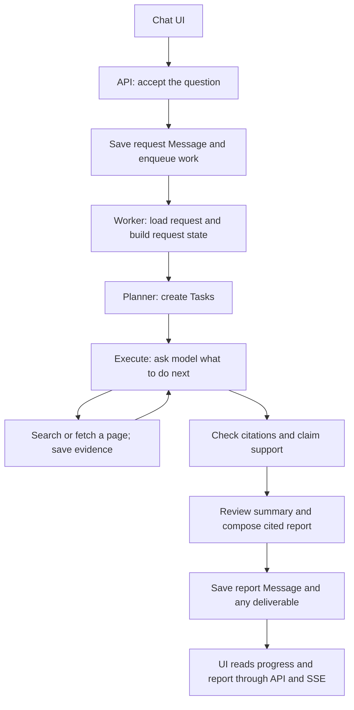

# Learning the ContextForge code

Start with one question: **What happens after I press Send?** Follow that path before reading
the supporting files. This guide describes the research build currently on disk; its offline
tests pass, but live acceptance of this build is still pending.

Start reading in `worker/workflow.py` at `_run_research_request`. It calls
`_plan_research_tasks`, `_execute_planned_tasks`, the evidence checks, and report writing.
`worker/request_state.py` creates the initial request state; `worker/dependencies.py` supplies
the shared model, tools and storage. The individual task graph is in `stages/execute.py`.
See [the terminology glossary](../GLOSSARY.md) for the difference between request state,
task state, task context and model context.

## The first ten minutes

The application saves your question, makes a plan, runs research tasks, checks their evidence,
and saves an answer. A model decides what to investigate; Python controls execution, storage,
limits and validation.



The diagram shows the main successful path. Clarification, cancellation, retries and exhausted
budgets add branches. Start with the main path, then study those branches.

The following is **pseudocode**, not an actual function to copy into the project:

```python
request = save_question_and_queue_work(question)
request_state = load_request_context(request)
plan = ask_model_for_plan(request_state)
tasks = validate_plan_and_save_tasks(plan)
results = run_tasks_when_their_dependencies_are_ready(tasks)
findings = check_saved_evidence_and_claim_support(results)
report = write_and_review_report(findings)
save_report_and_finish_request(report)
```

## The four folders

| Folder | Question it answers | Example |
|---|---|---|
| `api/` | How does the UI talk to the backend? | Submit, cancel, reply, read reports, receive SSE |
| `core/` | What records and shared rules does the application use? | Message shapes, repository interfaces, context building |
| `worker/` | How does a research request run? | Plan, execute tasks, check evidence, write report |
| `infra/` | How do we connect to external services? | Bedrock, web search, DynamoDB, S3, SQS, tracing |

`infra/runtime.py` connects the implementations. For example, a stage can use the same model
interface with a scripted model in a test or a Bedrock model in a real run.

Outside those folders, `prompts/` holds instructions sent to models, `config/` holds budgets,
routes and prices, `tests/` gives executable examples, and `evals/` holds research benchmarks.
The React frontend lives in the sibling `context-forge-frontend` repository.

## Five records to recognize

| Name | Meaning | Where to look |
|---|---|---|
| Chat | A conversation containing multiple requests and answers | [chat.py](../src/contextforge/core/entities/chat.py) |
| Message | A conversation entry; `kind` selects request, report, clarification, etc. | [message.py](../src/contextforge/core/entities/message.py) |
| Task | One planned piece of work belonging to a request | [task.py](../src/contextforge/core/entities/task.py) |
| Artifact | A record describing saved content, such as a page snapshot or full report | [artifact.py](../src/contextforge/core/entities/artifact.py) |
| ModelCall | One recorded attempt to invoke a model, including usage and cost metadata | [model_call.py](../src/contextforge/core/entities/model_call.py) |

A request is a `Message` with `kind=request`; we do not need a separate Job entity. Its
`message_id` identifies the overall request. A task's `request_message_id` points back to it.
One request may have several tasks, and one task may require several model calls and tool calls.
A model call can also happen outside a task, for example while planning or reviewing a report.

Artifacts belong to a chat. A fact points to evidence through an `EvidenceRef`, which identifies
the artifact, location and excerpt. The artifact record holds metadata and a `storage_ref`;
the actual saved bytes are read through the blob store. With AWS, that store uses S3.

The **request state** (`RequestState`) is the workflow's compact notebook: goal, constraints,
plan, retained facts, open questions and memory snapshot. It is defined in
[state.py](../src/contextforge/core/state.py), rather than being a separate domain entity.
`TaskState` holds one task's model/tool conversation and progress.

## Walk one question through the actual functions

Example: “Find the official release dates for Python 3.12.0 and 3.13.0, and say which is newer.”
The task split and search queries below are illustrative; the live planner chooses them.

| Step | What happens | Read this entry point |
|---|---|---|
| 1 | `POST /chats/{chat_id}/requests` passes the question to the application service | `create_app` in [api/main.py](../src/contextforge/api/main.py) |
| 2 | The service checks the chat, creates an ACCEPTED request and sends a work message | `Application.submit` in [application.py](../src/contextforge/core/services/application.py), then [submit_request](../src/contextforge/core/services/submit.py) |
| 3 | The consumer receives work; the runner claims the request and invokes its workflow | `QueueConsumer.handle` in [consumer.py](../src/contextforge/worker/consumer.py), then `RequestRunner.start` in [runner.py](../src/contextforge/worker/runner.py) |
| 4 | The workflow loads the request state and calls the planner; plan validation checks and saves Tasks | `_run_research_request` in [workflow.py](../src/contextforge/worker/workflow.py), then `create_research_plan` and `validate_and_save_tasks` in [plan.py](../src/contextforge/worker/stages/plan.py) |
| 5 | Ready tasks run in dependency waves; a task loops between model calls and tools | `_execute_planned_tasks` in workflow, then `build_task_graph`, `call_model`, `run_tools` in [execute.py](../src/contextforge/worker/stages/execute.py) |
| 6 | Search finds official release URLs; fetch reads pages and saves evidence snapshots | `WebSearchTool` and `FetchURLTool` in [web.py](../src/contextforge/infra/web.py) |
| 7 | The task submits structured findings with evidence references; the workflow gathers them | `TaskResult` in task.py and `_build_task_outcome` in execute.py |
| 8 | Code checks saved quotes and ownership; a model review checks whether the dates and meaning are supported | `check_citations` in [citation_checks.py](../src/contextforge/worker/stages/citation_checks.py), then `validate_research_findings` in [review.py](../src/contextforge/worker/stages/review.py) |
| 9 | The report stage checks the summary and comparison, composes cited text, saves the report and ends the request | `write_report` in [report.py](../src/contextforge/worker/stages/report.py), then `compose_research` in [research_report.py](../src/contextforge/worker/stages/research_report.py) |
| 10 | The UI receives progress through SSE and retrieves messages, artifacts and trace details | `event_stream` and the read routes in api/main.py |

For the first pass, read only the named functions and their immediate callers. Skip helpers
until you have a concrete question about them. In particular, `execute.py` is large: begin
with its three graph functions, not its first import or every error branch.

## Understand the model/tool loop

Within a web task, the model can ask to search, ask to fetch, or return its structured findings:

```text
Python builds context → model requests web_search(query)
Python checks limits → runs search → saves result → gives it to the model
Model requests fetch_url(url)
Python checks limits and permitted URL → fetches and saves page → gives it to the model
Model calls return_result with findings and evidence references
Python validates the result → the task ends
```

The model proposes tool names and arguments. Python performs the operation. `return_result`
submits a structured answer; it does not search. The outer workflow coordinates multiple tasks;
the inner graph runs this loop for one task. That explains why there are two orchestration levels.

Tool definitions describe names and argument schemas in
[tools/base.py](../src/contextforge/core/tools/base.py). The task-kind allowlist lives in
[worker/tools/__init__.py](../src/contextforge/worker/tools/__init__.py).

## How a model call is assembled

For planning/execution, the context builder assembles the relevant instructions, request state,
facts, source references, dependencies and conversation. Read `ContextInputs` and `build_context`
in [builder.py](../src/contextforge/core/context/builder.py). Some later stages instead build
small, dedicated evidence packets, so every stage does not receive the whole chat.

Stages request a client through `WorkerDependencies.model_for` in
[deps.py](../src/contextforge/worker/dependencies.py). Its wrappers select routes/fallbacks, check model
budgets and record attempts before reaching the provider adapter. Read their construction
there before exploring [calls.py](../src/contextforge/worker/calls.py),
[routing.py](../src/contextforge/worker/routing.py) and [bedrock.py](../src/contextforge/infra/bedrock.py).

Three kinds of input serve different purposes:

| Location | What it changes |
|---|---|
| [prompts/](../prompts) | Instructions given to the model: what to plan, extract, review or write |
| [config/](../config) and [settings.py](../src/contextforge/core/settings.py) | Routes, prices, limits and runtime options |
| Python stages and adapters | What operations are allowed and how results are validated and saved |

For example, “prefer primary sources” is a prompt instruction. Blocking the 51st web call is
an enforced Python/repository rule. The prompt cannot grant more calls.

## Learn in four short sessions

| Session | Read | Explain it back in your own words |
|---|---|---|
| 1: records and main flow, 20–30 min | Message, Task, Artifact; `_run_research_request` | How does one request turn into tasks and a report? |
| 2: actual research, 30–40 min | `call_model`, `run_tools`, the two web tools; active execute prompt | Who chooses a query, who runs it, and where does evidence go? |
| 3: quality controls, 30–40 min | `check_citations`, `validate_research_findings`, `write_report`; their tests | Why can a real quote still fail to support a claim? |
| 4: transport and services, 30–40 min | API submit, consumer, runner, `build_worker`, `model_for` | How do UI requests reach the workflow, and how do real providers replace test doubles? |

Read the active prompt versions from [context/prompts.py](../src/contextforge/core/context/prompts.py).
Older numbered prompt files are historical versions, not all active instructions.

## Small exercises that need no API or paid model

Run these from the backend root. The tests use controlled fixtures, not live research.

```sh
# Follow a complete research flow with a planted wrong-metric claim.
uv run --no-sync pytest tests/test_research_flow.py -v

# See why a quote's presence does not establish the claim's meaning.
uv run --no-sync pytest tests/test_research_review.py -v

# See concurrent tasks share one request's web allowance.
uv run --no-sync pytest tests/test_web_budget.py -v
```

Start with `ResearchFixtureModel.invoke` in
[test_research_flow.py](../tests/test_research_flow.py). It scripts the model's responses so you
can follow exactly which stage runs next. Then read that test's assertions: the wrong metric
must be withheld, available evidence preserved and the final report captured for review.

For an experiment, change the wrong-metric claim **in that test fixture only**, run the test,
inspect the changed outcome and restore your edit. The fixture's verdicts are scripted too;
the test demonstrates enforcement, not how intelligently a real model judges the new wording.

## Find the right file when something breaks

| Symptom | Start here |
|---|---|
| Wrong task split or malformed plan | plan.py, core/planner.py, active plan prompt, test_plan_stage.py |
| Search fails or a page is unreadable | infra/web.py, web_guard.py, test_web_research.py |
| Evidence exists but a finding disappears | execute result parsing, citation_checks.py, review.py, withheld-claim gaps |
| Report changes a finding's meaning | summary.py, review.py, research_report.py and their tests |
| Unexpected model choice or cost | deps.py, routing.py, calls.py, config/models.yaml, saved ModelCalls |
| Request stays ACCEPTED or RUNNING | application submit, consumer.py, runner.py, queue/checkpoint configuration |
| Live UI behaves like old code | `/health` build marker and API process; the server has no autoreload |

For any function you read, answer just three questions: **What comes in? What changes or gets
saved? What comes out?** For the first pass, leave AWS physical keys, compaction internals,
tracing internals and the root-level legacy prototype scripts for later. Return to them when
you are investigating that specific behavior.

For current delivery status and known limitations, use
[the research handoff](handoff-research-v2-2026-11-07.md). For measuring research quality after
the code path is familiar, use [the benchmark guide](evals/web-research-running.md).
