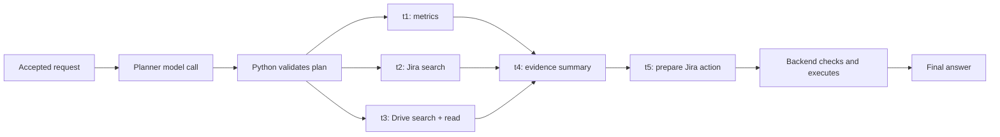

# Technical explanations — optional reference

**Keep two tabs open: this guide and [SESSION.json](../SESSION.json).** Expand one numbered
section of the JSON at a time. Everything else is reference material for questions.
Audience: engineers with 6–15 years of experience. Duration: 60 minutes.

The high-level architecture is already covered. Start after the user request is accepted.
Your teaching goal: explain **what the model receives, what it returns, what Python executes,
what gets stored, and what changes before the next model call**.

## Before you present

Say once: “This incident is a controlled teaching example. Provider tool names are documented;
incident data and model replies are fictional. The row-offload code is real. Private MCP
integrations, artifact read-back and Jira writes are proposed extensions, not a live demo.”

[Sources](../SOURCES.md) distinguish verified provider contracts from illustrative wrappers.
Do not send `SESSION.json` to an API: it contains presentation annotations and several layers
of data, not one executable request. Planner input is a complete Bedrock-shaped payload;
executor examples use logical roles. Later synthesis/action examples show proposed contracts,
not complete captured model invocations.

| Minutes | JSON section | Explain |
|---|---|---|
| 0–5 | `00_read_first`, request in `01` | User intent, supplied scope, entities |
| 5–17 | `01_request_and_planner` | Full prompt, roles, schema, plan → tasks |
| 17–27 | `02_execute_and_receive_data` | Model/tool loop and provider response formats |
| 27–36 | `03_store_and_shorten` | Full artifact versus incomplete preview |
| 36–45 | `04_read_back_and_continue` | Read saved data, aggregate, rebuild context |
| 45–53 | `05_synthesize_and_prepare_action`, `06_execute_action_and_answer` | Evidence → authorized action → final answer |
| 53–60 | Questions below | Failure handling, uncertainty and implementation gaps |

## 1. One user message starts the request

> Customers report a spike in login failures after a release. Pull login metrics, check
> recent Jira issues, and read the latest release notes in Google Drive. Draft a short
> evidence-backed summary and create a Jira ticket.

**Show:** `01.userRequestAndBackendContext`.

The backend supplies a fictional service (`auth-api`), environment, release ID, deployment
time, authorized source scope and matched windows. These were not magically inferred from
the user's short question. If required scope is unavailable, ask for clarification or resolve
it from an authorized source before querying broadly.

| Object | Role |
|---|---|
| Chat | Conversation containing many Messages; attachments belong to it |
| Request Message | User instruction; replaces “Job” in the earlier diagram |
| Request state | Working goal, plan, facts and gaps across tasks |
| Task | A planned unit of work with dependencies and a result |
| ModelCall | One model invocation and its recorded transcript |
| Artifact | Metadata pointing to saved bytes; not the bytes themselves |
| Report Message | The result the user sees |

**Say:** “One user message can cause many model calls and tool calls. They are different records.”

## 2. Build the planner's context, then validate its output

**Show:** `01.fullBedrockRequest`, then `01.scriptedPlan`.

| Input | Purpose |
|---|---|
| `system` | Planning rules, evidence discipline, no invented observations |
| `messages[0]` | Request, supplied scope and available capability descriptions |
| `toolConfig` | `return_result` with the expected plan JSON schema |
| Model/inference configuration | Which model and generation limits apply |

There is no assistant message yet on this first call. Assistant messages come from model
responses. A capability catalog inside the prompt describes what future tasks may use;
it does not mean the planner executes those research tools. Here its provider-level tool
is `return_result`, used to emit structured output.

The proposed plan uses `capabilities` arrays: the Drive task needs **search then read**.
`query_prometheus`, `searchJiraIssuesUsingJql`, `search_files`, `read_file_content` and
`createJiraIssue` are documented server names. Discover their actual input schemas and
permissions on the connected server. Datasource IDs and metric names are environment-specific.



Python checks task kinds, capabilities, references, dependencies and cycles. Model refs such
as `t1` become backend task IDs; see `illustrativePersistedTaskMapping`. This is a teaching
projection of the mapping, not a new implemented incident Task schema. Independent tasks
can run concurrently. Dependent tasks must account for failed or missing prerequisites.

**Say:** “Schema-valid means structurally acceptable. It doesn't prove the plan is useful.”

**Code, if asked:** `worker/stages/plan.py`: `create_research_plan`,
`validate_and_save_tasks`; `infra/bedrock.py`: `converse_payload`.

## 3. The executor calls a model; Python calls the tool

**Show:** `02.metricsAssistantCall`, then the response examples alongside it.

The executor gets its task goal, relevant context, allowed tool definitions and retained
history. It returns a tool name, arguments and call ID. Python validates and invokes the
adapter. The returned result is associated with the same call ID and enters the next request.

```text
system instructions + task context
  → assistant: query_prometheus(arguments), id=metrics-001
  → Python: authorized tool execution
  → tool: response, tool_call_id=metrics-001
  → next model call can use the returned evidence
```

These are logical roles. Our Bedrock adapter represents tool results as `toolResult` blocks
inside a `user` message. Do not confuse a provider's envelope with the application's message
abstraction. Transcripts show observable inputs/outputs, not hidden model computation.

### What format comes back?

| Layer | Format in this example |
|---|---|
| MCP transport result | JSON-RPC object; `result.content` holds content blocks |
| Grafana payload | JSON series with labels and timestamp/numeric-string pairs |
| Drive search | JSON file metadata/snippets; not complete document contents |
| Drive read | JSON with `fileContent`, a natural-language string |
| Python normalization | `ToolResult.rows` as dictionaries or `ToolResult.text` as a string |
| UI table | A rendering of data, not proof the source sent CSV |

Metrics: five regions × two outcomes × 120 minutes gives **1,200 samples**. Joining success
and failure by region/minute produces **600 rows**. Provider samples use numeric strings;
Python parses them and computes totals. Open the full provider envelope only if helpful:
[Grafana example](response-formats/02-grafana-mcp-envelope.json).

The normalized rows are synthetic fixtures. A real adapter must preserve provenance and
handle missing series, counter resets/extrapolation, non-integer results and warnings. For
real window totals, query whole matched windows rather than assuming summed minute estimates
are exact event counts. Grafana's MCP payload is not the Prometheus REST response envelope.

Drive requires `search_files` → returned file ID → `read_file_content`. See `02.driveCalls`,
`driveSearchPayload` and `driveReadEnvelope`. The decoded text is not a downloaded `.docx`.
The official Drive tools are Developer Preview and may return incomplete large content.
Jira examples are normalized application fixtures; the exact Rovo response was not captured.

**Ask the audience:** “If Python runs the tool but doesn't put the result into the next call,
what does the model know?” It has no new evidence from that call.

## 4. Save the complete result, shorten only the model view

**Show:** `03.artifactMetadata` and `03.actualPreviewMessage`.

The existing `process_rows` implementation keeps 50 rows, 20 columns and 200 characters per
string cell in this demo. When any shaping occurs, it saves **every original supplied row**,
unshaped, as NDJSON before returning a shortened preview.

```text
600 full normalized rows
  ├─ saved bytes: raw_result/{chatId}/{artifactId}.jsonl
  └─ prompt: “showing 50 of 600 rows; 550 more row(s) in artifact …” + JSON preview
```

The first 50 rows cover only the first ten baseline minutes. Every visible failure rate is
1%. **The preview does not contain the post-release spike.** Ask whether it is sufficient
to answer the user's question before showing the next step.

NDJSON/JSON Lines is one JSON object per physical line, without an enclosing array. A UI can
render those objects as rows. The Artifact record stores ownership, media type, byte size
and a storage reference. BlobStore holds bytes in memory here, or through S3 in deployment.
S3 does not convert them into tables, embeddings or model memory.

| Saved content today | Actual encoding | Key suffix |
|---|---|---|
| Offloaded rows | UTF-8 NDJSON, `application/x-ndjson` | `.jsonl` |
| Web snapshots | JSON, `application/json` | `.jsonl` currently, despite JSON contents |
| Datasets | CSV | `.csv` |
| Long deliverables | Markdown | `.md` |
| Model transcripts | JSON | `.json` |

The web suffix mismatch comes from the shared key builder; use media type and the reader's
contract, not the suffix alone. Generic row offloading does not automatically handle plain
`ToolResult.text`. Web fetch explicitly saves a snapshot; a future Drive adapter must do so too.

“Full” means full data passed to the processor. A provider may truncate before that. Also,
normalized rows are not original MCP wire bytes: a future adapter should preserve an original
JSON snapshot separately when exact replay is required. See `03.proposedDriveSnapshot`.

**Code:** `core/context/tool_results.py`: `process_rows`; `core/storage.py`: `BlobStore`.

## 5. Read evidence back, then construct the next model input

**Show:** `04.executorRequestWithPreview` → `backendReadAndAggregate` →
`fullNextExecutorRequest` → `scriptedTaskResult`.

The executor requests our proposed `query_artifact` tool, grouping all stored rows by window
and region. The backend resolves the artifact ID, checks user/chat/task access, reads the
NDJSON and performs deterministic aggregation. It returns ten regional groups and two totals.
An artifact ID alone grants no access; this tool still needs implementation and registration.

| Window, November 8 UTC | Failed / total attempts | Rate |
|---|---|---|
| 03:00–04:00 baseline | 3,000 / 300,000 | 1.0% |
| 04:00–05:00 post-release | 23,400 / 300,000 | 7.8% |

That is **6.8 percentage points**. us-east-1 rises from 1% to 35%; other regions stay at 1%.
Python computes from all saved rows. The model receives compact evidence, not all 600 rows.

The full next request contains five logical messages: task context, original metrics call,
preview, artifact-query call and matching aggregate result. It retains system instructions
and tool definitions. This is the key context-engineering moment: **inspect what changed
between the two calls**.

If history later grows too large, compaction may replace older results with reference stubs
and summaries. Saved data and model-visible context are separate. A stub does not enable
read-back automatically. For long text, a future bounded section-read tool could return the
relevant passage; our aggregate-only tool does not implement that operation.

If a planner needs the data again, a future replan input could carry an artifact catalog and
completed findings, then schedule a task with that artifact as input. This example does not
need a global replan: the executor completes its existing metrics task. Automatic replanning
and generic model-callable artifact reads are not currently implemented.

**Code:** `worker/stages/execute.py`: `_build_model_request`, `_result_message`;
`core/context/compaction.py`: `stub_old_tool_results`.

## 6. Evidence becomes a summary, an action and an answer

**Show:** sections `05` and `06`.

The summary combines three evidence types: computed metrics, a reported Jira hypothesis,
and a documented release change. The release timing is supplied scenario metadata. None
alone establishes root cause. Associate each claim with its source; keep unknowns visible.

The proposed action contains concrete Jira parameters. Backend code checks permissions,
project metadata, required fields, duplicates and configured policy. The user explicitly
requested creation; an extra confirmation is required only if applicable policy requires it.
Resolve evidence references into accessible links/attachments before executing the write.

Only a successful tool response supports “created ticket.” Section 06 is explicitly a
**simulated successful branch**. On an ambiguous create timeout, reconcile before retrying;
a local action ID alone does not make a remote create operation idempotent.

The current research path checks saved citation support and can use model-assisted semantic
review. Those are useful checks, not proof of truth, and the incident contracts here are not
yet integrated into that pipeline. Failed prerequisites must produce limitations or block
unsupported claims, even if other tasks finished.

**Say:** “We can support a measured spike and a plausible investigation direction. We cannot
yet support ‘the retry change caused the incident.’”

## Implementation boundary and questions

| Working in the project | Proposed in this incident example |
|---|---|
| Planning/task execution for supported task kinds | Private metrics/Jira/Drive integrations |
| Native search/fetch and dataset SQL tools | Incident-specific task/action schemas |
| Row shaping, artifact bytes and backend reads | General model-callable `query_artifact` |
| Context construction and compaction | Automatic global replanning |
| Evidence checks and report generation | Jira write workflow |

Use five questions to close:

1. Which input was supplied by the backend, and which output came from the model?
2. Why can the 50-row preview not answer the incident question?
3. What must survive when we remove a long tool response from the prompt?
4. Does a release note plus a spike prove root cause? What evidence is missing?
5. How do you avoid duplicate Jira tickets after an uncertain write outcome?

If someone asks about LangGraph, open `worker/workflow.py` for request scheduling and
`worker/stages/execute.py` for the task graph. `add_node` registers a step; `add_edge` fixes
its next step; `add_conditional_edges` selects a route from state; `compile` makes the graph
runnable. A node can be ordinary Python and does not necessarily represent an agent.

Keep these distinctions: request state versus task state; selected model context versus
stored application data; checkpoints versus learned memory; test correctness versus research
quality. A saved checkpoint does not guarantee exactly-once external operations.

## Preparation and reference files

Rehearse by collapsing all JSON sections and opening only the next stage. Explain each stage
using four words: **input, decision, execution, persistence**. Don't read every field aloud.

- [SESSION.json](../SESSION.json): the only JSON tab required for the main talk.
- [SOURCES.md](../SOURCES.md): merged official tool/response references.
- [reference/DETAILS.md](DETAILS.md): full readable planner prompt for preparation.
- [Full saved rows](06-full-metrics-artifact.jsonl): optional truncation comparison.
- [Current-runtime reference](../../../session-runtime-reference.md): optional actual-code fixture;
  it uses the older architecture question and does not execute this incident scenario.

Regenerate derived examples and the consolidated JSON from the repository root:

```sh
.venv/bin/python -m scripts.export_incident_artifact_demo
.venv/bin/python -m scripts.export_provider_response_examples
.venv/bin/python -m scripts.bundle_session_walkthrough
```

The planner fixture is reviewed static input; these commands preserve it. No paid calls or
external writes occur. The original detailed JSON remains under `reference/` for inspection.
