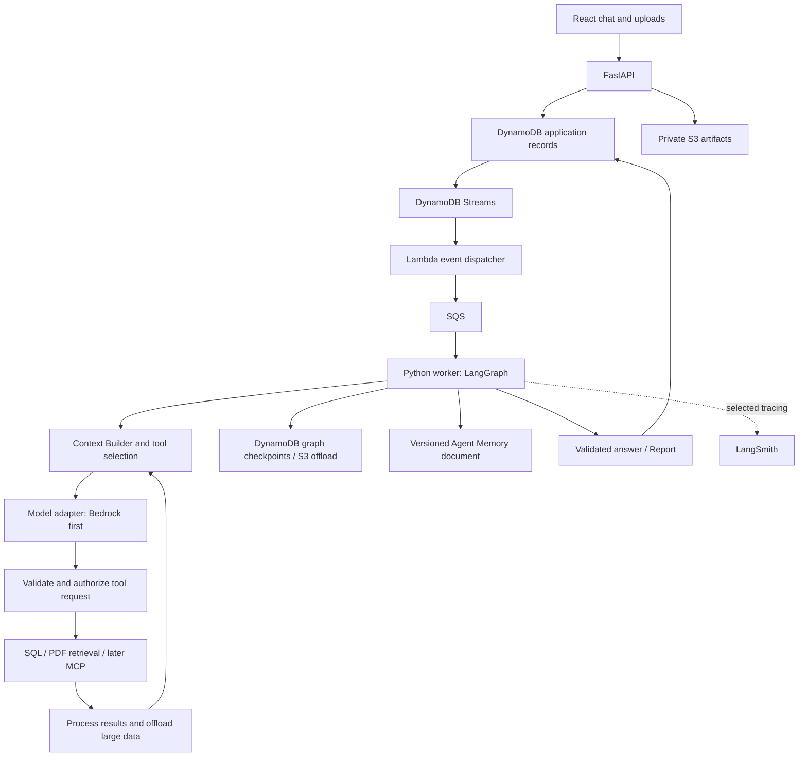

# ContextForge: system design and implementation plan

Project description: **AI Research Agent with Context Engineering and Persistent Memory**.

Updated: 4 November 2026, Asia/Kolkata.

This is the consolidated design reference for the project. It captures decisions from the conversation and labels recommendations requiring review. It supersedes older tentative recommendations in [architecture-context-decisions.md](architecture-context-decisions.md); that file preserves discussion history. This document does not mean the application or described AWS resources have been deployed.

Latest agreement: **Agent Memory** is the canonical name. Start with one versioned Markdown document for the default agent's procedural instructions; the planned filename is `agent-memory.md`. Our code must explicitly load the selected version into context; the filename has no automatic LangGraph behavior. Message now replaces Job. The finalized 9-entity model with fields is in [entity-model.md](entity-model.md): User added; TranscriptMessage dropped in favour of checkpoint state; ProposedAction and Report folded into Message as kinds; KnowledgeBase dropped in favour of indexStatus on Artifact. Do not create a separate memory table for the Agent Memory file. Structured learned facts and episodes remain a later design extension.

## 1. Goal and first example

Build a private assistant for spreadsheet analysis, PDF questions, and later Gmail/Drive research. The learning priorities are context engineering, Python, LangGraph, AWS, NoSQL modeling, MCP, observability, and evaluations, with very low initial spend.

The main example is: “Compare October spending with September; explain increases, investigate subscriptions and missing refunds, and check credit card bills. Cite evidence. Exclude confirmed transfers between my accounts and do not count both a card purchase and its bill settlement as expenses.”

Use synthetic transactions, PDFs, and simulated email responses first. SQL performs exact calculations. Models interpret results and investigate ambiguity. Equal payment amounts or reminder emails alone cannot establish whether a bill is settled. Preserve separate spending periods and the date through which payment status was checked.

## 2. Stack and boundaries

| Area | Choice | Status and reason |
|---|---|---|
| UI | Simple React + TypeScript | Fixed. Chat list on left; current conversation, uploads, answers and sources on right |
| API | Python + FastAPI + Pydantic | Fixed. Request validation, authentication boundary, application endpoints |
| Agent execution | Python worker running LangGraph | Fixed. One default agent configuration, bounded planning/tool loops and task branches |
| Observability | LangSmith | Fixed destination; add after the first LangGraph loop and before expanding integrations |
| Operational records | Amazon DynamoDB | Fixed direction. Design keys/indexes from concrete access patterns |
| Files and large outputs | Private Amazon S3 | Recommended. Originals, datasets, raw results, context snapshots and generated files |
| Model calls | Amazon Bedrock initially | Fixed. Select an affordable model that actually supports the required tools/structured output in our account and region |
| Provider changes | Model-provider adapter | Fixed direction. Add direct Anthropic/OpenAI APIs later without changing domain or memory storage |
| Durable graph persistence | Evaluate `langgraph-checkpoint-aws` DynamoDBSaver, with configured S3 offload | Recommended AWS path; validate a pinned release and restart/resume behavior before relying on it |
| Agent Memory | One versioned `agent-memory.md` document initially | Agreed for default procedural instructions across Chats; learned user facts/episodes and a DynamoDBStore-backed collection are deferred |
| Queue and dispatch | DynamoDB Streams → Lambda → SQS | Retain discussed design; scoped events, idempotency and a failure path |
| Spreadsheet querying | Isolated Python/DuckDB execution over selected S3 datasets | Recommended. DynamoDB is not the analytical payment database |
| PDF RAG | Explicit Python ingestion/retrieval; Bedrock embeddings + S3 Vectors target | Recommended. Learn the pipeline before evaluating managed Knowledge Bases |
| Authentication | AWS identity service, such as Cognito, before exposing private data remotely | Deployment decision to verify for account eligibility and cost; trusted local development first |
| Deployment | Local UI/API/worker first, with AWS services introduced deliberately | Recommendation for learning cost. AWS compute/hosting choice remains open |

LangSmith is intentionally outside AWS. Direct model providers would also be external. “AWS for our database and storage” does not imply that every service in the stack is an AWS service.

The official AWS integration package documents DynamoDBSaver and DynamoDBStore. Its existence avoids assuming we must add PostgreSQL or write persistence from scratch. Installation alone does not configure tables, credentials, retention, or our authorization rules. [AWS persistence integration](https://github.com/langchain-ai/langchain-aws/blob/main/libs/langgraph-checkpoint-aws/README.md), [published package](https://pypi.org/project/langgraph-checkpoint-aws/)

## 3. One agent, many Chats and requests

One default agent means one configured behavior, not one forever-growing model conversation. It can serve multiple Chats and run independent tools/tasks concurrently without multiple user-configurable agent identities.

- Chat groups user requests and selected conversation continuity.
- Message is a visible Chat entry. The initial user request Message also represents the request and carries its execution status; there is no separate Job entity.
- Task is bounded domain work, not necessarily a LangGraph node.
- A graph node is reusable code; it can execute many times for one Task.
- A planner is a model-calling node, not necessarily another service or autonomous agent.

Use a graph thread scoped to the initial request Message. Retry/resume uses that same workflow reference. Related Messages, Tasks and other execution records reference the initial message through requestMessageId. New requests select relevant earlier Chat messages, results and corrections explicitly. Do not merge concurrently active requests into one shared mutable scratchpad.



## 4. Logical entities

The finalized list has 9 entities; see [entity-model.md](entity-model.md). Internal model/tool exchanges stay in LangGraph checkpoints and LangSmith, not in an application record. **Agent Memory** is a named capability backed initially by a versioned document, not a new memory collection or table. Revisit structured memory records when learned cross-chat facts and episodes are implemented. Logical entities do not imply one table or service each.

| Entity | Purpose and creation boundary |
|---|---|
| User | Identity from the auth provider; owner of user-scoped records and a small preferences profile |
| Chat | Groups requests; API creates it when starting a chat |
| Message | Visible request, answer, clarification or action presentation; the initial user request carries execution status and is persisted before dispatch |
| Task | Goal, dependencies, execution attempts/status and structured result; orchestrator creates accepted planned work |
| Message kind=report | The answer, with claim-level evidence, inputs consulted and coverage in its report object; finalization creates exactly one per completed request |
| ModelCall | Invocation identity, model/provider, context reference, usage and outcome; model boundary records every actual call/attempt |
| Message kind=proposed_action | Exact proposed external operation, decision and execution outcomes in its action object; integration boundary creates it before external writes |
| Artifact | Source file, normalized dataset, raw result or generated output; upload/producing component registers it; indexStatus says whether the embedding index covers it |
| Integration | Provider-level configuration; integration manager configures it |
| IntegrationConnection | User's authorized provider account, scopes/status and credential reference; connection manager records verified setup |
| IntegrationTool | Provider operation/schema and permission classification; tool discovery synchronizes it |

Keep Task.result rather than a separate Finding entity. No separate TokenUsage entity: usage belongs to ModelCall. No separate Node, Edge, Checkpoint, Trace, or Span business entities duplicating framework internals. No Agent entity is needed solely for a constant `default-agent` configuration.

Message owns the visible conversation, with separate sender (`from`) and purpose (`type`). Only an explicitly classified new user request starts execution; clarification replies and action decisions resume the existing request. `from == "user"` alone cannot classify new work. Execution status belongs to the initial request Message, not every entry. Internal model/tool exchanges remain in graph state. A proposed external operation is a Message of kind proposed_action with an immutable payload; the answer is a Message of kind report with a report object. Neither is a separate table. Avoid competing mutable copies of answer/action content. See the [handoff](entity-model-handoff.md) for candidate fields and relationships.

Task.result has a candidate common bounded envelope: `summary`, typed `structuredData`, `evidenceRefs`, `artifactRefs`, `uncertainties`, and `coverage`. Task-specific results are validated. Add an explicit result-format version only if multiple incompatible formats actually need to coexist. Large rows/results remain in Artifacts. DynamoDB's entire-item size limit is 400 KB, not an intended result size. [DynamoDB constraints](https://docs.aws.amazon.com/amazondynamodb/latest/developerguide/Constraints.html)

Record-format versioning recommendation: do not require a generic `schemaVersion` field on initial Chat or Message records. It identifies a record's layout, not how many times the record was updated, and does not automatically migrate or validate data. Add it when incompatible persisted formats must coexist and readers need explicit identification; otherwise use backward-compatible additions or deliberate migrations. Graph, prompt and Agent Memory versions remain separate provenance concerns.

Artifacts need owner/access scope, immutable source/version identity, storage reference, locations and derivation links. A Report distinguishes inputs consulted, evidence supporting claims, and files generated as outputs; it does not union every Task artifact into one attachment list. Reports may exist without PDF output.

## 5. Memory: scope versus content

Short-term and long-term describe **where recall applies**. Semantic, episodic and procedural describe **what is remembered**. Long-term is not an additional fourth content type. LangGraph uses checkpoints for thread state and stores for cross-thread memory. [Memory concepts](https://docs.langchain.com/oss/python/concepts/memory), [long-term store](https://docs.langchain.com/oss/python/langchain/long-term-memory)

| Layer | Example | Proposed storage and retrieval |
|---|---|---|
| Agent Memory: default procedural instructions | Cite sources; preserve uncertainty; financial calculation conventions | One versioned developer-controlled `agent-memory.md` document, explicitly loaded by Context Builder |
| Request scratchpad / working brief | Current plan, completed work, gaps and unresolved matches | Graph state persisted through request-scoped checkpoints; selected fields enter calls |
| Chat continuity | “Exclude the laptop purchase” in a follow-up | Relevant prior Messages/results and a versioned Chat summary if needed |
| Semantic long-term memory (later) | User-confirmed preference for INR; confirmed account aliases | User-scoped Agent Memory records/profile, retrieved by relevance; storage design deferred |
| Episodic long-term memory (later) | A dated, verified reconciliation and what resolved its ambiguity | Curated Agent Memory records with source/outcome references; storage design deferred |
| Plans intentionally spanning Chats | A learning goal with milestones | Versioned owned plan Artifact; later Agent Memory can reference it, while each active request retains separate execution state |

The scratchpad was not conceptually absent: it was the working brief. Make it explicit in the graph schema, rather than adding a standalone Scratchpad entity. Durability over several days does not make every scratchpad fact suitable for future unrelated Chats.

Global developer instructions can be shared by the single default agent. Learned user facts remain private to that user across their Chats. A single agent does not justify a global bucket mixing everyone's financial memories.

### Agent Memory: versioned file first, learned records later

Use Markdown for default procedures, initial seed notes and import/export. A file can be a valid first prototype, but its format does not remove the need for identity, scope, provenance, revision, relevance and deletion. Deep Agents and Claude tools demonstrate file-backed approaches; those harness features are not automatically enabled by LangGraph. [Deep Agents memory](https://docs.langchain.com/oss/python/deepagents/memory), [Claude memory tool](https://platform.claude.com/docs/en/agents-and-tools/tool-use/memory-tool)

The initial agreed implementation is one active version of `agent-memory.md`, with prior versions retained for history/rollback. Store it as controlled application configuration or a versioned private S3 document; choose one canonical source. Do not create a new document per Chat, request, or model call. Record the selected instruction version/hash with ModelCall. The file is not automatically writable by the model. A normal upload remains an Artifact until explicitly reviewed and designated for the appropriate memory scope.

If learned cross-chat memory grows, revisit a structured collection under the same **Agent Memory** terminology. That is a later extension, not a prerequisite for the initial procedural file.

Possible future Agent Memory record envelope (not part of the initial file implementation):

```text
memoryId, ownerUserId, agentId=default-agent
kind: semantic | episodic | procedural
content or artifactRef; topic/tags
sourceRefs; revision
status: candidate | active | superseded | deleted
createdAt, updatedAt, lastVerifiedAt?, expiresAt?
```

When learned memory is introduced, start with explicit “remember this,” user corrections, and reviewable imports. Do not automatically promote every task result. Add reviewed episodic examples later and compare quality against a no-episode baseline. Default privileged policies are not writable through ordinary memory tools.

Do not save “this bill is unpaid” as a timeless preference. Keep it in dated evidence, reverify when asked again, and retrieve historical episodes only as examples. Do not place OAuth tokens or raw account/card credentials in memory. Retrieved permission claims never grant access.

Memory retrieval uses trusted user+agent namespaces and current active/expiry checks. Concurrent updates require revision/conflict handling; two requests must not overwrite a shared profile silently. Deletion must remove active retrieval/index entries, with an explicit policy for retained source histories/checkpoints. A deletion cannot undo context already sent to a provider.

DynamoDBStore is a candidate persistence building block, not a complete memory policy. Its basic search without vector configuration is namespace listing with filters, not semantic ranking. Documented client-side filtering/scans and update guarantees need evaluation. Start with a small profile and bounded kind/tag retrieval; add an index only when needed. [DynamoDBStore details](https://github.com/langchain-ai/langchain-aws/blob/main/libs/langgraph-checkpoint-aws/langgraph_checkpoint_aws/store/dynamodb/DynamoDBStore.md)

## 6. Context engineering contract

Use write, select, compress and isolate as the design vocabulary. Save originals externally; bring relevant information into context; reduce redundant detail; keep task exploration separate. [LangChain Context Engineering](https://www.langchain.com/blog/context-engineering-for-agents)

Before every model invocation, Context Builder selects:

1. Versioned default instructions and mandatory runtime constraints.
2. Current question and relevant Chat corrections.
3. Relevant active user memories, explicitly separated from source evidence.
4. Current task/working brief, exact supported facts and unresolved gaps.
5. Authorized, versioned evidence needed for this decision.
6. Only relevant permitted tool schemas.
7. Recent valid exchanges and required tool-call/result associations.

Define a token budget including response allowance and a margin; count actual inputs. No universal fixed compaction threshold is assumed. Never silently drop a pinned constraint, qualifier, or failed-source coverage flag.

Tool Result Processor filters, paginates, aggregates or extracts before model input. Preserve large originals as Artifacts with scoped read/search access. Summarize bounded text only when necessary. A summarizer itself has a context limit; deterministic SQL should calculate monetary totals. Compaction retains intent, constraints, exact results, uncertainty, source references and next steps. [Anthropic context engineering](https://www.anthropic.com/research/effective-context-engineering-for-ai-agents)

ModelCall references the actual selected context and source/policy/tool revisions. Preserve exact payloads only under the chosen privacy/retention policy and mark any redactions. Compact model input is distinct from the full transcript, full checkpoint, and raw evidence.

## 7. Tool retrieval: the user's “REG” idea

The term is **RAG-like tool retrieval**, tool search, or progressive disclosure. MCP discovery inventories tools; retrieval selects a relevant subset; authorization determines whether they can execute.

```text
MCP tool discovery -> IntegrationTool catalog
                              |
Task goal -> connected/authorized candidates -> rank -> schema budget
                                                        |
                                                  model proposal
                                                        |
                                              validate + authorize
                                                        |
                                                   execute tool
```

For 20–30 tools, start with namespaces, capability tags, aliases and lexical/BM25 ranking in Python. This is not a DynamoDB full-text feature. Load full schemas for only the selected tools and necessary companions, such as search followed by read. If discovery misses a capability, allow bounded `search_tools` refinement instead of exposing everything or inventing a call. Recheck revoked scopes/connection status at execution.

IntegrationTool remains canonical. A tool index is derived infrastructure, not another entity. Add embedding/hybrid retrieval only after measuring recall failures or meaningful catalog growth; keep separate namespaces/evaluation from document RAG. No vector database is required merely because an MCP has 30 tools.

LangChain's LLMToolSelectorMiddleware is an alternative, but adds a selection-model call over candidate names/descriptions; count its usage. Provider-native deferred tool search is another optional optimization. Current Anthropic documentation distinguishes Bedrock InvokeModel from Converse support, so verify the chosen API/model before relying on it. Our baseline remains application-owned and provider-neutral. [Selector source](https://github.com/langchain-ai/langchain/blob/master/libs/langchain_v1/langchain/agents/middleware/tool_selection.py), [native tool search](https://platform.claude.com/docs/en/agents-and-tools/tool-use/tool-search-tool)

## 8. LangGraph execution and ownership

Use a hybrid flow: understand/clarify -> build working brief -> plan -> validate -> bounded execution -> prepare task results -> evaluate evidence gaps -> targeted follow-up or report.

LangGraph coordinates nodes, branches, dependencies, retries, checkpointing and interruptions. Our code defines allowed tools, permissions, plan validation, accounting rules, context policy, completion criteria and spend/step limits. Planning must apply transfer/double-count rules before calculating spending, not ask an LLM to subtract them from a finished explanation.

Transient retries differ from semantic corrections and replanning. Preserve accepted outputs, deduplicate IDs and avoid charging/counting a replayed saved output as a fresh model call. Checkpoint restart/resume does not guarantee exactly-once external writes. Nodes interrupted for approval can restart from their beginning. [LangGraph persistence](https://docs.langchain.com/oss/python/langgraph/persistence), [interrupts](https://docs.langchain.com/oss/python/langgraph/interrupts)

ProposedAction preserves exact payload/version/hash, decision identity/time and execution attempts, including uncertain outcomes. Resume verifies actor, pending state and payload before continuing. Initially all integrations are read-only. Graph runtime state is authoritative for continuation; execution statuses on request Messages and Tasks are maintained projections with a reconciliation path, not independent competing schedulers.

## 9. Dispatch, files and API outline

The API persists the initial user request Message before returning an accepted response. Dispatch only explicit accepted-request and authorized-resume events. Streams/Lambda/SQS are at least once: deduplicate delivery and protect each workflow with execution ownership. Neither sender-only filtering nor ordinary Message/checkpoint/task-status writes may start new work. Clarification responses and action decisions target a verified pending interruption and resume the same request. Paused work is persisted and acknowledged; continuation is scheduled rather than holding a queue message for days. Submission retries also need server-side deduplication; a message ID alone does not prevent two request submissions. The existing insert-only bridge prototype does not yet implement these behaviors.

Uploads use private scoped object references. Register uploaded Artifacts as Chat attachments, available to authorized requests in that Chat without copying source lists into each request Message. Validate type/size; ingestion extracts text or produces typed, versioned transaction datasets. SQL execution is isolated from the API/agent credentials, receives only the selected dataset, and has time/memory/output limits. Regex checks for SELECT are not a security boundary.

Candidate API resources for a later contract review: Chats and their Messages; request status/result/cancel/resume addressed by the initial Message ID; Artifact upload registration/completion; ProposedAction decision; IntegrationConnection setup. Agent Memory CRUD/import APIs are deferred until learned memory is introduced; the initial procedural document uses controlled versioned configuration. Identity comes from verified server-side authentication, not a submitted userId. Use SSE for live progress/answer updates and regular APIs for submission and clarification/approval responses. An initial request-scoped stream follows the board; exact endpoints and any later Chat-wide multiplexing remain open. Disconnecting the stream does not cancel execution. Reopening loads saved Messages/status and reconnects; missed updates require server-side replay or a state refresh. No APIs are implemented by this document.

## 10. Observability is measurement; evaluation judges quality

LangSmith records nested runs/traces for planning, retrieval, tools, models, compression and reporting. Propagate chatId/requestMessageId/taskId/modelCallId and stage/version metadata. A request may span multiple traces after interruptions. Task IDs are not node names. [LangSmith observability](https://docs.langchain.com/langsmith/observability-concepts)

| Question | Measurement / evaluation |
|---|---|
| Is it working? | Completion/errors, correct final results, evidence-backed answers |
| What did a Task do? | Correlated model/tool/retrieval spans and accepted Task.result |
| Too many calls? | Total/repeated tool calls and discovery rounds, compared with correctness |
| Are tools selected well? | Necessary-tool recall, unauthorized-tool exclusion, invalid-argument rate |
| Is context effective? | Input tokens, retained constraints, citation coverage, recovery after compaction |
| Does memory help? | Cross-Chat recall, stale/irrelevant-memory rate, edit/delete/isolation tests |
| What does it cost? | Actual provider token usage, estimated model costs, separate AWS service costs |

Fewer calls do not prove better behavior: omitting verification can lower cost while making an answer wrong. LangSmith shows behavior; fixtures, verifiers and review establish quality. Provider cost estimates need correct model/pricing metadata and may differ from invoices/credit deductions. Unknown usage after a timeout is not zero. Do not add parent trace totals to the same child model usage again.

Use application-side budget admission and per-request runtime policies (not required Message fields) independent of trace sampling/availability. LangSmith is not the system of record, memory store, recovery engine or enforcement mechanism. Begin tracing synthetic data, then use deliberate masking/disabled payload capture for real financial/Gmail data, including outputs/errors/metadata. [Trace privacy controls](https://docs.langchain.com/langsmith/mask-inputs-outputs)

## 11. Provider adapter and credits

The model boundary accepts normalized messages, selected tools, response schema and generation limits, and returns normalized results/tool requests, actual provider/model identity, usage and errors. Start with a supported Bedrock integration; direct Anthropic/OpenAI adapters can be added later. Test tool-call IDs, structured output, streaming, token accounting and context limits for each provider. Memory and business entities remain application-owned.

Changing generation provider does not change stored embedding compatibility. Changing embedding model/dimension requires re-embedding into an appropriate versioned index. Do not silently send private prompts to a different provider or use fallback routing outside the configured policy.

Credits are not an application budget or a guarantee that every model is eligible. Check actual model access, free-plan eligibility, pricing and retention configuration before paid calls. Regional availability does not guarantee account access. [Bedrock model access](https://docs.aws.amazon.com/bedrock/latest/userguide/model-access.html), [Bedrock pricing](https://aws.amazon.com/bedrock/pricing/)

Important: adding an external model key does not extend AWS Free Plan resources. AWS documents that the Free Plan ends after six months or depleted credits, whichever occurs first, and the account then closes unless upgraded under its terms. Plan an explicit cost/continuity decision and data export before that point; no automatic paid upgrade is approved. [AWS account plans](https://docs.aws.amazon.com/awsaccountbilling/latest/aboutv2/free-tier-plans.html)

## 12. Region and cost posture

Use one region. Prior account inspection found Sydney (`ap-southeast-2`) assigned by the project signup; Mumbai was the original preference, not a completed migration. Reverify account state and available models/services before provisioning. S3 Vectors documentation currently lists both regions, but account/plan permissions remain separate. [S3 Vectors regions](https://docs.aws.amazon.com/AmazonS3/latest/userguide/s3-vectors-regions-quotas.html)

An earlier $5 monthly usage-alert budget was created; alert email verification was pending at that time. Recheck it before AWS work. That alert is not a hard stop. Also recheck completion of the user-led MFA setup.

Keep fixtures small, limits explicit, retention short where appropriate, and sensitive payloads out of generic logs. No always-running vector cluster or managed agent platform is required for the first slice. Hosting, identity, encryption/secrets services and model usage can each incur costs; estimate the selected deployment rather than promising a zero-cost app.

## 13. Implementation phases and completion criteria

| Phase | Deliverable | Done when |
|---|---|---|
| 0. Design contracts | Review this plan, context boundaries, Agent Memory file contract, access patterns and ownership | One worked request has unambiguous inputs, state, evidence and output contracts |
| 1. LangGraph foundation | Small Python graph, fake read-only tool, explicit model/context boundary, persistent checkpoint proof | A request completes; restart/resume works; duplicate delivery cannot start duplicate active work |
| 2. LangSmith | Nested traces, IDs, model usage and redacted payload policy | Each task's calls/errors/timing are visible and usage is not double counted |
| 3. Chat + AWS persistence | React chat list, FastAPI Messages/request execution, private upload flow, DynamoDB/S3, minimal queue bridge | Two Chats remain isolated, uploads are owner-scoped, and request execution survives process restart |
| 4. Spreadsheet slice | Typed ingestion, isolated SQL, exact sums, context/result contracts, report evidence | September/October fixture totals and exclusions match known answers |
| 5. Agent Memory | Versioned procedural file and explicit context loading; then separately review learned memory | Same active instructions apply across Chats, restart preserves the selected version, and rollback/version tracing work; learned preference tests follow when that extension is built |
| 6. PDF RAG and tool discovery | Chunk/embedding retrieval, source/page citations, permission-filtered tool selection | Relevant passages/tools are recalled without loading the whole corpus/catalog |
| 7. Read-only Gmail/Drive MCP | OAuth connections, scoped catalog, bill/refund investigation | Model/tool versions verified; evidence is reconciled; revocation and missing access behave correctly |
| 8. Advanced context evaluation | Reviewed episodes, forced compression, stale-source/conflict tests | Quality survives bounded context; needed offloaded details are recoverable; cost/latency tradeoffs are measured |
| 9. External writes and hosting | Approval/execution reconciliation and selected AWS deployment | Only exact approved actions execute; uncertain outcomes reconcile; hosting cost and auth are reviewed |

Memory foundations and correlation IDs are designed from phase 1 even though learned memory arrives later. LangSmith remains planned immediately after the first graph, not postponed until the end. Use mocks/local emulation before any phase's billable calls; actual AWS acceptance requires a bounded live smoke check after account/access review. Do not report a mocked test as proof of cloud end-to-end delivery.

No fixed calendar estimates are promised before the first slice. Do not build the entire 20-task system before learning from one complete small flow.

## 14. Required evaluation scenarios

- Own-account transfer excluded; card purchase and settlement not double counted.
- Equal-amount payment to another destination does not prove this bill was paid.
- A promised refund without a corresponding credit remains unresolved.
- A newer statement invalidates results derived from its older version.
- Oversized outputs are offloaded before they enter a model request.
- Forced compaction preserves exclusions, uncertainty, original goal and next action; originals can be retrieved.
- User memory works across Chats but not across owners; corrections/deletions and concurrent edits behave predictably.
- Tool search finds search/read companion capabilities; revoked or write-only capabilities remain blocked.
- Duplicate queue events, resumed nodes and tool timeouts do not create duplicate work or blind repeated external writes.
- Model usage, selection/compression calls and provider changes remain visible and budgeted.

See the research report for targeted compression testing: [Context Management for Deep Agents](https://www.langchain.com/blog/context-management-for-deepagents). Its SDK thresholds are examples, not settings automatically inherited by our LangGraph app.

## 15. Remaining decisions and existing prototype

Review Agent Memory file location/version loading, result schemas, first model/API, package lock/compatibility, region/account eligibility, checkpointer persistence/concurrency behavior, SQL isolation, identity and hosting. DynamoDB keys, index and conditional writes are settled in [entity-model.md](entity-model.md). Learned-memory records and promotion rules remain later extensions. They are not reasons to reopen the fixed React/FastAPI/LangGraph/LangSmith direction.

Existing bridge/template/test scripts are an earlier narrow DynamoDB-to-SQS prototype. They are not the finished app or a deployed end-to-end system. Preserve them as reference until deliberately integrating or replacing them. This documentation work changes no runtime code or AWS account resources.

## Mental model and interview check

Default instructions are the operating handbook; a request scratchpad is the current notebook; user memory is a scoped set of reusable notes; Artifacts preserve evidence. Context Builder selects what goes on the desk for the next decision.

One liner: **LangGraph runs the work, our context/memory policies choose the information, AWS stores it, and LangSmith makes behavior measurable.**

Interview question: Why separate checkpoints from cross-chat memory? Checkpoints preserve the execution state of a particular workflow. Cross-chat memory holds selected reusable information with separate scope, provenance and lifecycle; copying every checkpoint into future prompts would inject stale and irrelevant state.

## Research and prior discussion links

- [Memory research](research/memory-design-research.md)
- [Tool discovery research](research/tool-discovery-research.md)
- [Earlier decisions and source reading list](architecture-context-decisions.md)
- [Project glossary](../GLOSSARY.md)
- [Anthropic multi-agent research architecture](https://www.anthropic.com/research/multi-agent-research-system)
- [Anthropic tool design](https://www.anthropic.com/research/writing-tools-for-agents)
- [LangChain newer memory/context overview](https://www.langchain.com/blog/context-engineering-deep-agents-remember)
