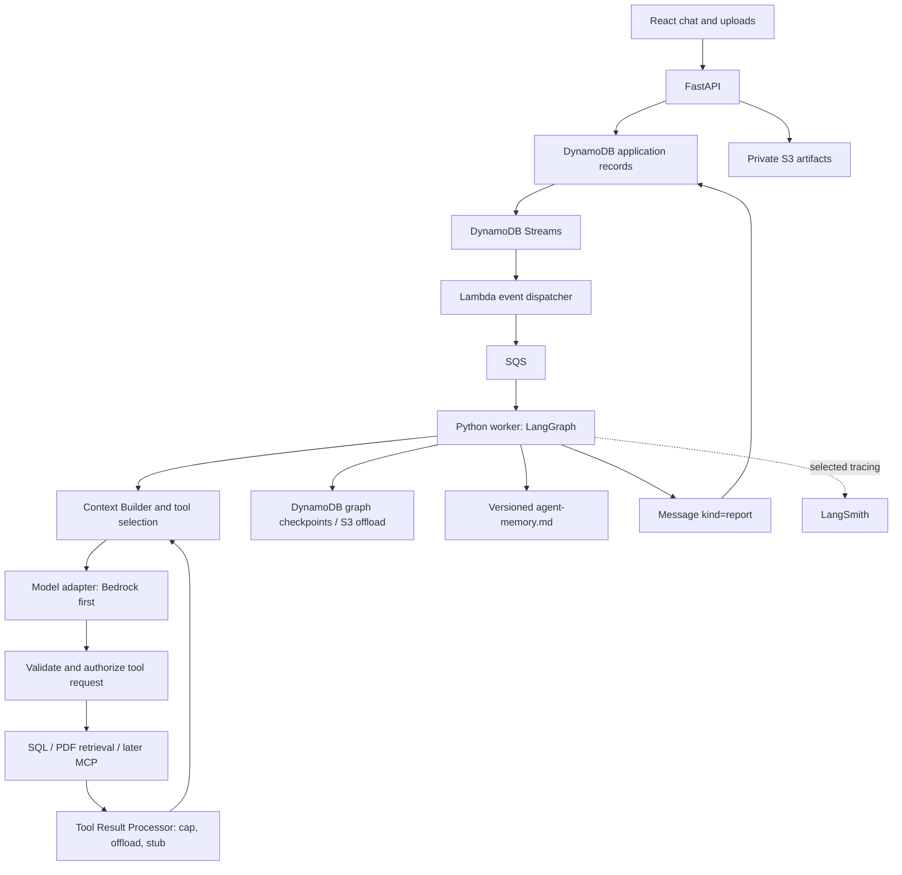

# ContextForge: system design

**AI Research Agent with Context Engineering and Persistent Memory.**

Updated: 4 November 2026, Asia/Kolkata. This is the high-level design: what the system is, the fixed choices, the vocabulary, the architecture, and the decisions behind them. The low-level model, physical storage, prompts and phase tasks are in [implementation-plan.md](implementation-plan.md). Status and open items are in [progress.md](progress.md). Nothing here means the application or any AWS resource has been built or deployed.

## 1. Goal and first example

Build a private assistant for spreadsheet analysis, PDF questions, and later Gmail/Drive research. The learning priorities are context engineering, Python, LangGraph, AWS, NoSQL modeling, MCP, observability, and evaluations, with very low initial spend.

The main example: "Compare October spending with September; explain increases, investigate subscriptions and missing refunds, and check credit card bills. Cite evidence. Exclude confirmed transfers between my accounts and do not count both a card purchase and its bill settlement as expenses."

Use synthetic transactions, PDFs, and simulated email responses first. SQL performs exact calculations. Models interpret results and investigate ambiguity. Accounting rules apply before SQL totals, not after.

Domain rules that are fixed:

- A transfer between the user's own accounts is not spending.
- A card purchase and the bill payment that settles it are one expense, counted once.
- An equal amount alone does not prove a bill was paid. A reminder alone does not prove it was unpaid.
- Spending periods stay separate. Every answer states the date through which payment status was checked.
- Monthly totals alone cannot establish subscriptions, expected refunds, or settled bills.
- "This bill is unpaid" is dated evidence, never a timeless fact.

## 2. Stack and boundaries

| Area | Choice | Status and reason |
|---|---|---|
| UI | React + TypeScript | Fixed. Chat list on the left; conversation, uploads, answers and sources on the right |
| API | Python + FastAPI + Pydantic | Fixed. Validation, authentication boundary, application endpoints |
| Agent execution | Python worker running LangGraph | Fixed. One default agent configuration, bounded planning and tool loops, task branches |
| Observability | LangSmith | Fixed destination; added after the first LangGraph loop and before expanding integrations |
| Operational records | Amazon DynamoDB, one table | Fixed. See section 13 for the DynamoDB-versus-Postgres decision |
| Files and large outputs | Private Amazon S3 | Originals, datasets, raw results, generated files |
| Model calls | Amazon Bedrock first, behind a provider adapter | Fixed direction. Verify model access, tool use and structured output support in the account and region before paid calls |
| Graph persistence | `langgraph-checkpoint-aws` DynamoDBSaver with S3 offload; SQLite checkpointer locally | Validate a pinned release and restart/resume behavior before relying on it |
| Agent memory | One versioned `agent-memory.md` | Default procedural instructions across Chats. Learned facts and episodes deferred |
| Queue and dispatch | DynamoDB Streams, Lambda, SQS | Scoped events, idempotency, failure path |
| Spreadsheet querying | Isolated Python/DuckDB over typed datasets in S3 | DynamoDB is not the analytical database |
| PDF retrieval | Explicit Python ingestion and retrieval; Bedrock embeddings, S3 Vectors target | Learn the pipeline before managed knowledge bases |
| Authentication | AWS identity service such as Cognito before remote exposure | Trusted local development first |
| Deployment | Local UI, API and worker first; AWS services introduced deliberately | Compute and hosting choice remains open |

LangSmith is outside AWS. Direct model providers would also be outside AWS. "AWS for data and storage" does not mean every service is an AWS service. No Spring Boot.

## 3. Glossary

Agreed names. "Avoid" lists names that were considered and rejected.

| Term | Meaning | Avoid |
|---|---|---|
| User | An authenticated person identified by the identity provider, owning Chats, Artifacts, IntegrationConnections and a small preferences profile | Client-supplied userId; learned facts stored on User |
| Chat | A grouping of related user requests and follow-ups | Conversation, as the entity name |
| Message | A user-visible entry in a Chat. The initial user request Message also represents the work being executed; a report Message is the answer; a proposed_action Message is an external operation awaiting a decision | Job, Report, ProposedAction as separate records |
| Request | A unit of user-requested work, represented by its initial Message. Clarification replies and approval decisions continue an existing Request | Every user Message as a new Request |
| Task | A bounded unit of work within a Request, with a goal, authorized inputs, status and a compact result | A graph node; LangGraph's internal task object |
| Task result | The usable outcome of a Task: summary, typed data, evidence references, uncertainties, coverage | Finding as a separate entity |
| TranscriptMessage | An ordered internal exchange during execution, held in LangGraph checkpoint state and LangSmith traces | A stored application entity |
| ModelCall | One model invocation with stage, model identity, context version, usage and outcome | TokenUsage as a separate entity |
| Artifact | A stored source or produced object: upload, dataset, raw result, deliverable | Context snapshot as an artifact kind |
| Integration | A supported external provider and how to reach and authenticate with it. Developer configuration | A user's account connection |
| IntegrationConnection | A user's authorized account at a provider, with a credential reference | Plaintext tokens anywhere |
| IntegrationTool | One operation a provider offers, with schema and permission classification | A tool index as an entity |
| Working brief | The typed LangGraph state for one Request: goal, constraints, plan, facts, open questions, next action, pending interrupt, messages | A stored entity; a global scratchpad shared by requests |
| Agent memory | The default agent's versioned procedural instructions, `agent-memory.md`; later, learned records | MemoryEntry as an initial entity |
| User memory | The small preferences profile on User now; later, user-scoped learned records | Shared facts across users |
| Context snapshot | The instructions, evidence, messages and tools presented to one ModelCall; observed in LangSmith | A stored record in early phases |
| Evidence reference | A link to an Artifact plus a locator (page, row, cell, range, message, section) supporting a claim | An unrelated attachment as proof |
| KnowledgeBase | Not an entity. Searchable sources are Artifacts with an index status; embedding settings are application config | A collection record before a requirement exists |

## 4. Architecture

### One agent, many Chats and requests

One default agent means one configured behavior, not one forever-growing model conversation. It serves many Chats and runs independent task branches concurrently without multiple agent identities.

- Chat groups user requests and continuity.
- Message is a visible Chat entry. The initial request Message carries execution status; there is no separate Job.
- Task is bounded domain work. A graph node is reusable code that can execute many times for one Task.
- A planner is a model-calling node, not another service.
- Each request has its own LangGraph thread, whose id is the request messageId. Retry and resume use that thread. Concurrently active requests never share mutable state.



### Nine logical entities

User, Chat, Message, Task, ModelCall, Artifact, Integration, IntegrationConnection, IntegrationTool. Fields, shapes and storage are in the implementation plan.

```text
                              User
          ┌─────────────────────┼──────────────────────┐
         1│*                   1│*                    1│*
        Chat               Artifact            IntegrationConnection
         1│                   ▲ chatId                 *│
         *│                   │ derivedFrom            1│
       Message                │                   Integration ──1:*── IntegrationTool
   kind=request owns status   │
   kind=report owns report{}  │
   kind=proposed_action       │
     owns payload, status     │
         │ requestMessageId   │
     ┌───┴────┐               │
   Task    ModelCall          │
     │ inputArtifactIds ──────┤   authorized sources
     │ result.evidenceRefs ───┘   what was actually used
   report.claims[].evidenceRefs ─► Artifact + locator
```

Removed during review and where each went: Job became the request Message; TranscriptMessage lives in checkpoints and traces; ProposedAction and Report became Message kinds; KnowledgeBase became an index status on Artifact plus application config; Finding became Task.result; TokenUsage became ModelCall.usage. No entities for Node, Edge, Checkpoint, Trace, Span or a single constant Agent.

### Ownership boundaries

- Application records own user identity, source authorization, accepted requests and results, approvals and external operation outcomes, and the usage needed for budgets.
- LangGraph's checkpointer owns resumable graph state, node progress, checkpoint lineage and pending interrupts. Working state is never reconstructed from traces.
- LangSmith owns observability traces. A run is an observed operation, not an application entity. A paused and resumed request can produce several root traces.
- Execution status on the request Message and on Tasks is a maintained projection of graph state with a reconciliation path, not a second scheduler.

## 5. Memory: scope versus content

Short-term and long-term describe where recall applies. Semantic, episodic and procedural describe what is remembered. Long-term is not a fourth content type. LangGraph uses checkpoints for thread state and a store for cross-thread memory.

| Layer | Example | Storage and retrieval |
|---|---|---|
| Procedural, developer rules | Cite sources; preserve uncertainty; accounting conventions | One versioned `agent-memory.md`, loaded by the Context Builder on every call, never model-writable. ModelCall records its version |
| Working brief | Current goal, constraints, plan, facts, gaps, next action | Typed LangGraph state per request, checkpointed. Not an entity |
| Chat continuity | "Exclude the laptop purchase" in a follow-up | Relevant prior Messages and Task results, selected explicitly. A Chat summary only when measurably needed |
| Semantic, user facts | Preferred currency, timezone | Small preferences profile on User now. A user-scoped collection later when facts grow, because a profile becomes error-prone as it grows |
| Episodic | A dated, verified reconciliation and what resolved it | Later: curated records from completed requests, retrieved as examples only, never as current status |
| Plans spanning Chats | A learning goal with milestones | A versioned owned Artifact; each active request keeps separate execution state |

Rules:

- Memory writes are explicit first: "remember this", corrections, reviewed imports. Automatic promotion of task results comes later and only against a no-episode baseline.
- Writing new procedures at runtime is the riskiest memory operation (CoALA). Agent instructions are developer-controlled. An uploaded Markdown file is an Artifact until explicitly reviewed and scoped.
- Retrieval checks owner, active status and expiry in application code. A retrieved permission claim never grants access. Credentials never enter any memory tier.
- Concurrent updates need revision checks; two requests must not silently overwrite a shared profile. Deletion must remove retrieval entries, with an explicit policy for retained checkpoints. Deletion cannot undo context already sent to a provider.
- DynamoDBStore is a candidate building block for later learned memory, not a memory policy. Its search without a vector index is namespace listing with filters.

Later record envelope, not part of the initial build: `AgentMemoryRecord { memoryId, userId, kind: semantic | episodic, content or artifactRef, tags, sourceRefs, revision, status: candidate | active | superseded | deleted, createdAt, updatedAt, lastVerifiedAt?, expiresAt? }`.

## 6. Context engineering

Vocabulary: write, select, compress, isolate. Save originals externally; bring relevant information into context; reduce redundant detail; keep task exploration separate.

### Four tiers

```text
 Tier               Lives in            Size per request   Lifetime      Reaches the model by
 Context window     one ModelCall       ≤ 40k tokens       one call      it is the call
 Working brief      LangGraph state     ≤ 3k tokens        one request   selected fields, every call
 Durable records    DynamoDB            small              forever       Task.result and prior Messages, selected
 Artifacts          S3                  unbounded          forever       tools, just in time, bounded slices
```

Nothing moves down a tier unless it is small enough for that tier. Rows never enter the brief. Transcripts never enter DynamoDB. Whole files never enter the context window.

### Before every model call

The Context Builder selects, in this order:

1. The versioned agent memory file and mandatory runtime constraints.
2. The brief's goal, constraints and next action.
3. The brief's facts, capped, with evidence references.
4. Open questions.
5. Result summaries of the tasks this call depends on.
6. Evidence slices needed for this decision, loaded just in time through tools.
7. Only the tool schemas selected by tool search, three to five, never the catalog.
8. The current loop's messages, compacted when over budget.

Define a token budget with a response allowance and a margin; count actual inputs. No universal fixed compaction threshold. Never silently drop a pinned constraint, qualifier, or failed-source coverage flag.

### Tool Result Processor

Sits between every tool and the model. Filters, paginates, aggregates or extracts before model input. Large results go to a raw_result Artifact and are replaced with a stub naming the artifact and how to read a slice. The model decides whether it needs more. Deterministic SQL computes monetary totals; a summarizer never does.

### Compaction

Only the brief's `messages` is ever compacted. Three levels, lightest first: stub old tool results; isolate task branches as subgraphs whose transcripts are dropped on completion; summarize all but the last few messages with a compress-stage call. Compaction keeps decisions, constraints, exact results, uncertainty, source references and next steps. Recall before precision. Never split a tool call from its result. Details and numbers are in the implementation plan.

## 7. Tool retrieval

The user's "RAG for tools" is retrieval-augmented tool selection, also called tool search or progressive disclosure. MCP discovery inventories tools; retrieval selects a relevant subset; authorization decides whether they can execute.

```text
MCP tools/list -> IntegrationTool catalog
                              |
Task goal -> connected + authorized candidates -> rank -> schema budget
                                                        |
                                                  model proposal
                                                        |
                                              validate + authorize
                                                        |
                                                   execute tool
```

- For 20 to 30 tools, rank lexically on name and description in Python. No vector service, no selector-model call. Add embeddings only after measured recall failures.
- Load full schemas for selected tools only. If discovery misses a capability, allow bounded refinement rather than exposing everything or inventing a call.
- Permission filtering happens before ranking; current scopes are rechecked at execution. Relevance is not permission.
- An MCP server returns name, inputSchema, usually description, sometimes title, outputSchema and annotations. Annotations are untrusted. Read/write classification is a developer decision.
- Provider-native tool search and LangChain's LLMToolSelectorMiddleware are optional optimizations with their own costs and platform limits. The baseline is application-owned and provider-neutral.
- Real catalogs are large: five Box tools carried about 6,000 characters of description. Loading a whole catalog into every call is the failure mode this design prevents.

## 8. LangGraph execution and ownership

Hybrid flow: understand and plan in one call, which returns either a plan or a clarification question; validate the plan in code; bounded execution in isolated task subgraphs; reconcile; cite; report.

LangGraph coordinates nodes, branches, dependencies, retries, checkpointing and interruptions. Our code defines allowed tools, permissions, plan validation, accounting rules, context policy, completion criteria and step and spend limits.

- Transient retries, semantic corrections and replanning are distinct. Accepted outputs are preserved; a replayed saved output is never counted as a fresh model call.
- Checkpoint resume does not guarantee exactly-once external writes. A node interrupted for approval can restart from its beginning. Resume verifies the actor, the pending state and the payload before continuing.
- All integrations are read-only until phase 10. A WRITE or DESTRUCTIVE tool requires a proposed_action Message; approval is distinct from execution; a failed write becomes UNCERTAIN and the model reads to verify before any retry.
- Deadlines, maximum steps and tool calls, concurrency and spend limits are enforced in code. Per-request budget is the sum of ModelCall usage.

## 9. Dispatch, files and API outline

- The API persists the initial request Message before returning an accepted response. The insert is the accepted-request event. Resume goes from the API to SQS directly.
- Streams, Lambda and SQS are at least once. Submission uses a client idempotency key held in a short-TTL record; execution uses conditional status transitions so duplicate delivery resolves to existing work. Neither sender filtering nor ordinary status writes may start new work.
- Paused work is persisted and acknowledged; continuation is scheduled, not held on a queue for days.
- Uploads: the API registers the Artifact and returns a signed S3 URL; the client uploads; the API confirms completion, validates type and size, and ingestion produces a typed dataset Artifact for spreadsheets or an embedding index entry for PDFs. SQL execution is isolated from API and agent credentials, receives only the selected dataset, and has time, memory and output limits. Regex checks for SELECT are not a security boundary.
- The API contract is implementation-plan section 11: sixteen endpoints over plural resources (`/chats`, `/chats/{chatId}/messages`, `/chats/{chatId}/requests/{messageId}`, `/chats/{chatId}/artifacts`, `/me`), one error shape, cursor paging. Identity comes from verified server-side authentication, never a submitted userId.
- SSE streams progress and answer updates per request (events `request`, `task`, `message`); regular endpoints submit requests and resolve clarifications and approvals. Disconnecting does not cancel execution. The stream closes on a terminal status or WAITING_USER; on reconnect the client refetches state, there is no server-side replay. The API learns about progress by polling the repository once per second per open stream.

## 10. Observability and evaluation

LangSmith records nested runs for planning, retrieval, tools, models, compression and reporting. Propagate chatId, requestMessageId, taskId and modelCallId with stage and version metadata. Task ids are not node names.

| Question | Measurement or evaluation |
|---|---|
| Is it working? | Completion and errors, correct final results, evidence-backed answers |
| What did a Task do? | Correlated spans and the accepted Task.result |
| Too many calls? | ModelCall counts by stage, discovery rounds, compared with correctness |
| Are tools selected well? | Necessary-tool recall, unauthorized-tool exclusion, invalid-argument rate |
| Is context effective? | Input tokens, retained constraints, citation coverage, recovery after compaction |
| Does memory help? | Cross-Chat recall, stale-memory rate, edit, delete and isolation tests |
| What does it cost? | Provider usage, estimated model cost, separate AWS costs |

Fewer calls do not prove better behavior. LangSmith shows behavior; fixtures, verifiers and review establish quality. Unknown usage after a timeout is not zero. Do not add parent trace totals to child usage. Budget admission runs in the application, independent of tracing. Begin tracing on synthetic data; mask payloads for real financial or Gmail data.

Required evaluation scenarios:

- Own-account transfer excluded; card purchase and settlement not double counted.
- Equal-amount payment to another destination does not prove this bill was paid.
- A promised refund without a corresponding credit remains unresolved.
- A newer statement invalidates results derived from its older version (spreadsheet phase 3 extension, with `supersedesArtifactId`).
- Oversized outputs are offloaded before they enter a model request.
- Forced compaction preserves exclusions, uncertainty, original goal and next action; originals can be retrieved.
- User memory works across Chats but not across owners; corrections, deletions and concurrent edits behave predictably.
- Tool search finds search-then-read companions; revoked or write-only capabilities stay blocked.
- Duplicate queue events, resumed nodes and tool timeouts do not create duplicate work or blind repeated external writes.
- Model usage, selection and compression calls, and provider changes remain visible and budgeted.

Start with about twenty representative requests; large effects show at that size. Use an LLM judge with a rubric plus end-state checks; human review stays essential.

## 11. Provider adapter, credits, region and cost

- The model boundary accepts normalized messages, selected tools, response schema and generation limits, and returns normalized results, actual model identity, usage and errors. Memory and entities stay application-owned. Changing generation provider does not change stored embedding compatibility; changing embedding model requires re-embedding into a versioned index.
- Model split: a strong model for plan and cite, one call each; a cheap model for execute, tool_select and compress loops. Verify tool use and structured output support per model in the account and region. Bedrock pricing differs from first-party rates.
- Credits are not a budget. The AWS Free Plan ends after six months or depleted credits; plan a cost and continuity decision and data export before then. No automatic paid upgrade is approved.
- One region. Prior inspection found Sydney (`ap-southeast-2`) assigned; Mumbai was a preference, not a migration. Reverify account state, model access, the $5 usage alert and MFA before provisioning.
- Keep fixtures small, limits explicit, retention short, and sensitive payloads out of generic logs.

## 12. Principles from research

Primary sources: Anthropic engineering posts on context engineering, long-running harnesses, tool design and the multi-agent research system; LangChain memory and context-engineering documentation; the CoALA paper.

| Component | Finding | Applied here |
|---|---|---|
| Context curation | Smallest set of high-signal tokens; recall degrades as context grows; curate before every call | Context Builder order; token budget; compaction levels |
| Tool interface quality | The agent-computer interface deserves as much design as a human interface; few non-overlapping tools; pagination and truncation defaults; actionable errors | IntegrationTool description is the main lever; Tool Result Processor caps output |
| Structured notes outside the window | Plans and progress persist as structured state, not transcript; models overwrite free-form notes; compaction alone is not enough | Typed working brief with pinned fields |
| Isolation with condensed hand-backs | Sub-agents return 1,000 to 2,000 token summaries and store large output externally | Task subgraphs; Task.result envelope; raw_result Artifacts |
| Resume from checkpoints | Stateful errors compound; resume rather than restart | DynamoDBSaver; conditional status transitions |
| Risk-classified tools and approval gates | Classify by risk; approve destructive operations; bound iterations | IntegrationTool.permission; proposed_action Messages; step and spend limits |
| Tracing plus a small evaluation set | About twenty queries; LLM judge with rubric; end-state evaluation | Section 10 |
| Separate citation pass | Attach claims to sources after synthesis | ModelCall stage `cite` |
| Procedural memory is developer-seeded | Runtime procedure writing is the riskiest memory operation | `agent-memory.md` is not model-writable |
| Simplicity | Workflows with predefined paths before free agents; add complexity only when measured | Hybrid flow with bounded loops |

## 13. Decisions log

Dated decisions that later work must not silently reverse.

| Date | Decision | Reason |
|---|---|---|
| 3 Nov 2026 | React, FastAPI/Python, LangGraph, LangSmith, DynamoDB, S3, Bedrock-first are fixed | Learning goals and low cost |
| 3 Nov 2026 | Finding, TokenUsage, Scratchpad, ContextSnapshot, AuditEvent, Node/Edge/Checkpoint/Trace/Span are not entities | Covered by Task.result, ModelCall, graph state, LangSmith |
| 3 Nov 2026 | Agent memory starts as one versioned `agent-memory.md`; no memory table | Procedural rules first; learned memory deferred |
| 4 Nov 2026 | Message replaces Job; request Message owns execution status; `sender` and `kind` are separate; only an explicit request starts work | Users also answer clarifications and approve actions |
| 4 Nov 2026 | No generic `schemaVersion` on records | Add explicit format versions only for a real coexistence requirement |
| 4 Nov 2026 | User entity added, with a small preferences profile | Owner for user-scoped records and memory |
| 4 Nov 2026 | TranscriptMessage dropped as an entity | Checkpoints and traces already hold it |
| 4 Nov 2026 | ProposedAction and Report folded into Message kinds | Same pattern as the request Message; report versioning dropped |
| 4 Nov 2026 | KnowledgeBase dropped; `indexStatus` on Artifact; embedding config in application config | One corpus, one embedding configuration, one user |
| 4 Nov 2026 | Field name `sender` not `from`; category fields named `kind` | `from` is a Python keyword |
| 4 Nov 2026 | Artifact: no contentHash, no supersedesArtifactId, no requestMessageId until needed; datasets are separate records linked by `derivedFromArtifactId` | No current requirement; forward references already exist |
| 4 Nov 2026 | Stay with DynamoDB over RDS | Relations are all parent-child; nine access patterns are all single-partition reads; idle cost is zero; NoSQL modeling is a learning goal. Repository layer is the hedge |
| 4 Nov 2026 | One table, one sparse GSI, on-demand, Streams on, PITR on; request URLs chat-scoped; `integrationToolId` derived from `integrationId:name`; `Artifact.chatId` required | Access-pattern-first design |
| 4 Nov 2026 | Working brief is typed LangGraph state, not an entity; no budget counter in state | Budget from ModelCall records |
| 4 Nov 2026 | Integration rules adopted from a reviewed production design: pre-flight schema validation before a proposed_action; approval identity is the argument hash; failed writes become UNCERTAIN; missing tools after re-sync are disabled, not deleted | Proven in production |
| 4 Nov 2026 | Understand and plan are one model call; it returns a plan or a clarification | Fewer calls; the planner sees the sources |
| 4 Nov 2026 | API: plural resources, sixteen endpoints, one `replies` endpoint for both clarification answers and approval decisions, `artifactIds` on submit validated not stored, `/me` singular | Collections take ids; both replies are "answer the pending interrupt and resume" |
| 4 Nov 2026 | SSE: three persisted event types carrying full records, heartbeat, close on terminal or WAITING_USER, no replay, refetch on reconnect, API polls the repository per second | Simplest correct design at one user; no pub/sub infrastructure |
| 4 Nov 2026 | `decision` field added to action_response Messages; Chat gains ARCHIVED | Decisions must be machine-readable; archive instead of delete |
| 4 Nov 2026 | Phases reordered for learning value: evals to phase 2, spreadsheet before UI, thin UI in phase 4, PDF retrieval with hybrid and metrics in 5, memory 6, MCP client and server in 7, stress and cost in 8, AWS in 9, writes and hosting in 10; journal entry per phase | Interview readiness is the priority; cross-checked against the ranked top-20 list in Box |
| 4 Nov 2026 | Eight defaults confirmed: tooling (Python 3.12, uv, pytest, ruff, mypy), local runtime until phase 9, fake model first then Bedrock, compaction numbers as config, 60-row fixture, `Chat.lastRequestStatus`, transient `activity` SSE event, `User.instructions` | Unblocks phase 1; the three new fields each have a user expectation behind them |

## 14. Implementation phases

Revised 4 November 2026. The ordering goal is learning and interview readiness for AI engineering roles, so the AI concepts come first and the UI and cloud work arrive only as thick as a concept needs. Question codes (F1, P3, A5) refer to the ranked top-20 AI engineer interview list kept in Box ("Top 20 AI Engineer and AI Platform Engineer Interview Questions, 2025 to 2026", Golden Resources folder). Expectation numbers refer to implementation-plan section 11.1.

| Phase | Build | Concepts you can then explain | Interview questions it answers | Expectations and endpoints |
|---|---|---|---|---|
| 0 Design | Done | | | |
| 1 Engine, local | LangGraph graph, typed state, SQLite checkpoints, interrupts, structured planner output, idempotent dispatch, the execute loop written by hand inside a node (model, tool, model) | Agent versus workflow, state versus transcript, human in the loop, resume, at-least-once versus exactly-once, structured output | F3, P1, P5 (structured output half), P6 | 10, 13; no endpoints |
| 2 Real model, tracing, first eval | Model adapter with bounded retries, backoff with jitter and timeouts; LangSmith; ModelCall usage; model split; a ten-request eval harness: deterministic checks first, LLM judge with a rubric for fuzzy qualities, judge checked against your own labels, run before every prompt or model change | Observability, token accounting, retries, model routing, golden sets, judge bias, regression gates | P2, P3, P10 (the habit) | 16; no endpoints |
| 3 Spreadsheet slice | DuckDB `sql_query` tool, tool result processor, evidence refs, abstention through `uncertainties`, cite stage as a verifier pass, compaction on real data, deliverables | Tool design, result truncation and offload, grounding, citations, confident-wrong mitigation, compaction policy, tool output as untrusted data | P4, P5 (injection half), A5 (compaction) | no endpoints |
| 4 Thin API and UI | E1 to E8 and SSE, timeline, inline replies, cancel, in-process worker, dev login; minimal React, no polish | Streaming to a client, the interrupt round trip through an API, idempotent submit, what happens between prompt and streamed output | F2 (application side), P6 | 1, 2, 4, 7, 9, 11, 12, 14, 15, 23 (dev) |
| 5 PDF retrieval | Chunking, Bedrock embeddings, S3 Vectors, BM25 plus vector hybrid, reranker, page citations, owner-scoped retrieval, retrieval eval with recall@k and MRR on known answers | RAG end to end and where it fails, chunk size tradeoffs, hybrid and rerank, retrieval metrics, permission-scoped retrieval, when not to use RAG | F1, F5, A1 | 17 (PDF), 21 |
| 6 Memory | `User.instructions`, versioned `agent-memory.md`, then `AgentMemoryRecord` for learned facts and episodes with provenance and expiry | Procedural, semantic, episodic; short versus long term; what the model may write; memory pollution | A5 (memory) | 6, 22, 8; E14 |
| 7 MCP both ways | Gmail and Drive read-only as an MCP client with OAuth and catalog sync; our own tools (`sql_query`, `search_chunks`, `read_artifact`) exposed as an MCP server; lexical tool retrieval; pre-flight schema validation; injection tests on tool output | MCP versus function calling, building and securing a server, tool search, least privilege | P9, P5 | 24; connection endpoints |
| 8 Context stress, cost, latency, incident | Forced compression tests, conflict and stale-source cases, prompt caching, cost per request, time to first token versus total time, an incident drill: break something, find it in the trace, fix, write it up | Context rot, caching economics, cost and quality tradeoffs, latency levers, incident narrative | P7, P8, P10, A5 (cheap) | none |
| 9 AWS persistence | DynamoDB, S3, Streams to Lambda to SQS, DynamoDBSaver, real identity, per-user budgets at the adapter | Single-table design, event-driven dispatch, serverless cost model, tenancy boundaries | A3 (partly) | 23 (real), 3, 5, 19, 20; E9 to E13, E15, E16 |
| 10 Writes and hosting | Proposed actions on real tools, approval identity by argument hash, reconciliation, UNCERTAIN handling, deployment, cost review | Guardrails, escalation, blast radius, failed-write verification | A2 | 11 (real writes) |

Not taught by this project, reading only: transformer and inference internals (F2 model side, A4), fine-tuning and LoRA (F4), timed data-structure problems. Keep them on the study list; do not add them to the build.

Rules that hold across phases:

- Evals exist from phase 2 and every later phase reports a number from them.
- At the end of each phase, write a one-page journal entry outside the repository: what was built, the choice and its alternative, what broke, and the answers to that phase's questions in your own words. By phase 10 the interview preparation is written.
- Memory foundations and correlation ids are designed from phase 1. Mocks and local emulation precede every billable call; cloud acceptance needs a bounded live smoke check. No calendar estimates before the first slice. Do not build the whole system before learning from one complete small flow.

## 15. Mental model

Default instructions are the operating handbook; the working brief is the current notebook; user memory is a scoped set of reusable notes; Artifacts preserve evidence. The Context Builder selects what goes on the desk for the next decision.

One line: LangGraph runs the work, our context and memory policies choose the information, AWS stores it, and LangSmith makes behavior measurable.

Why separate checkpoints from cross-chat memory? Checkpoints preserve the execution state of one workflow. Cross-chat memory holds selected reusable information with its own scope, provenance and lifecycle; copying every checkpoint into future prompts would inject stale and irrelevant state.

Does tool retrieval replace access control? No. Relevance neither proves authorization nor guarantees correctness; filter by permission before ranking and enforce it again at execution.

## 16. Readings

- Anthropic: [Effective context engineering for AI agents](https://www.anthropic.com/engineering/effective-context-engineering-for-ai-agents), [Effective harnesses for long-running agents](https://www.anthropic.com/engineering/effective-harnesses-for-long-running-agents), [Building effective agents](https://www.anthropic.com/research/building-effective-agents), [Writing tools for agents](https://www.anthropic.com/engineering/writing-tools-for-agents), [Multi-agent research system](https://www.anthropic.com/research/multi-agent-research-system), [Memory tool](https://platform.claude.com/docs/en/agents-and-tools/tool-use/memory-tool), [Tool search tool](https://platform.claude.com/docs/en/agents-and-tools/tool-use/tool-search-tool)
- LangChain and LangGraph: [Memory concepts](https://docs.langchain.com/oss/python/concepts/memory), [Long-term memory](https://docs.langchain.com/oss/python/langchain/long-term-memory), [Context engineering for agents](https://www.langchain.com/blog/context-engineering-for-agents), [Context management for Deep Agents](https://www.langchain.com/blog/context-management-for-deepagents), [How Deep Agents remember](https://www.langchain.com/blog/context-engineering-deep-agents-remember), [Deep Agents memory](https://docs.langchain.com/oss/python/deepagents/memory), [Graph API](https://docs.langchain.com/oss/python/langgraph/graph-api), [Persistence](https://docs.langchain.com/oss/python/langgraph/persistence), [Interrupts](https://docs.langchain.com/oss/python/langgraph/interrupts), [MCP](https://docs.langchain.com/oss/python/langchain/mcp), [LLMToolSelectorMiddleware](https://github.com/langchain-ai/langchain/blob/master/libs/langchain_v1/langchain/agents/middleware/tool_selection.py)
- LangSmith: [Observability concepts](https://docs.langchain.com/langsmith/observability-concepts), [Threads](https://docs.langchain.com/langsmith/threads), [Model-call instrumentation](https://docs.langchain.com/langsmith/log-llm-trace), [Mask inputs and outputs](https://docs.langchain.com/langsmith/mask-inputs-outputs), [Evaluation types](https://docs.langchain.com/langsmith/evaluation-types)
- AWS: [langgraph-checkpoint-aws](https://github.com/langchain-ai/langchain-aws/blob/main/libs/langgraph-checkpoint-aws/README.md), [DynamoDBStore](https://github.com/langchain-ai/langchain-aws/blob/main/libs/langgraph-checkpoint-aws/langgraph_checkpoint_aws/store/dynamodb/DynamoDBStore.md), [DynamoDB constraints](https://docs.aws.amazon.com/amazondynamodb/latest/developerguide/Constraints.html), [Bedrock model access](https://docs.aws.amazon.com/bedrock/latest/userguide/model-access.html), [Bedrock pricing](https://aws.amazon.com/bedrock/pricing/), [S3 Vectors regions](https://docs.aws.amazon.com/AmazonS3/latest/userguide/s3-vectors-regions-quotas.html), [AWS account plans](https://docs.aws.amazon.com/awsaccountbilling/latest/aboutv2/free-tier-plans.html)
- MCP: [Tools specification](https://modelcontextprotocol.io/specification/2025-06-18/server/tools)
- Research: [CoALA: Cognitive Architectures for Language Agents](https://arxiv.org/html/2309.02427v3)
